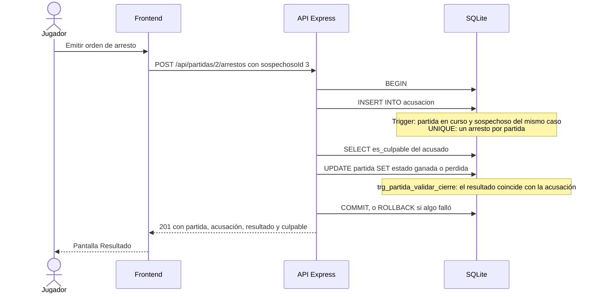
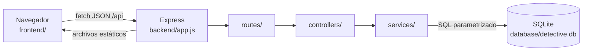

# Documentación técnica de Detective SQL

Base para el informe final del trabajo práctico integrador. Explica el juego, el modelo de datos, las consultas, las reglas que impone la base, la aplicación y las pruebas.

- **Fuente de verdad:** [`database/detective.sql`](../database/detective.sql). Si algo de este documento no coincide con el script, gana el script.
- **Instalación y comandos:** [`README.md`](../README.md).
- **Aviso:** este documento incluye la solución del caso (secciones 7 y 9).

| Secciones | Tema |
|---|---|
| 1 y 2 | El juego y el flujo de una partida |
| 3 a 6 | Modelo de datos: entidades, MER, modelo relacional, 3FN y diccionario |
| 7 a 10 | SQL: consultas, reglas, transacciones y vista |
| 11 y 12 | Aplicación: arquitectura y tecnologías |
| 13 | Pruebas y resultados |
| 14 y 15 | Uso de IA y mejoras futuras |

## Pendientes del equipo

Todo lo marcado como **Para completar por el equipo** en este documento. Nada de esto se puede generar sin el equipo.

- [ ] Documento del equipo: nombre, roles, habilidades y recursos ([Equipo](#equipo)).
- [ ] Reglas del juego escritas con palabras propias, si el equipo lo desea ([sección 1](#1-descripción-y-reglas-del-juego)).
- [ ] Capturas de pantalla de la aplicación ([sección 2](#2-flujo-completo-de-una-partida)).
- [ ] Capturas del MER y del modelo relacional dibujados en Miro ([sección 4](#4-propuesta-de-mer-y-modelo-relacional-para-revisión-del-equipo)).
- [ ] Revisión final del MER generado con ayuda de IA ([sección 4](#4-propuesta-de-mer-y-modelo-relacional-para-revisión-del-equipo) y [sección 14](#14-uso-de-ia-y-correcciones-realizadas)).
- [ ] Prueba de instalación en Windows y con la versión de Node.js de cada integrante ([sección 13](#13-matriz-de-pruebas-y-resultados-verificables)).
- [ ] Revisión de las decisiones que la bitácora marca como pendientes ([sección 14](#14-uso-de-ia-y-correcciones-realizadas)).

## Equipo

Integrantes y roles: ver [Participantes en el README](../README.md#participantes).

> [!IMPORTANT]
> **Para completar por el equipo:** documento del equipo con nombre del equipo, rol de cada integrante, habilidades que aporta cada uno y recursos utilizados (equipos, software, horarios de trabajo, repositorio y tablero de Miro).

---

## 1. Descripción y reglas del juego

### Descripción

Detective SQL es un juego de investigación. El jugador recibe un expediente, revisa escenas, evidencias, interrogatorios y coartadas, y tiene **un solo intento** para arrestar al culpable. Todo lo que ve sale de consultas SQL sobre una base SQLite, y la base decide si el arresto fue correcto.

Caso cargado: **"El silencio del archivo"**.

> La directora del archivo municipal fue asesinada a las 21:30. Cuatro personas mintieron sobre su ubicación. Solo una cometió el crimen.

| Dato | Valor en la semilla |
|---|---|
| Fecha y hora del crimen | 2026-11-09 21:30, escena principal |
| Lugar del crimen | Archivo municipal (oficina) |
| Apertura del expediente | 2026-11-10 |
| Escenas | 3: Archivo municipal (21:30, principal), Estacionamiento municipal (21:20) y Cafe Bahia (21:10) |

| Sospechoso | Relación con la víctima | Coartada declarada (2026-11-09, 21:00 a 22:00) |
|---|---|---|
| Elisa Rivas | Hermana de la victima | Hospital Central |
| Bruno Torres | Exsocio de la victima | Domicilio de Bruno |
| Carla Mendez | Empleada del archivo | Restaurante Central |
| Diego Salas | Proveedor del archivo | Gimnasio Norte |

Los textos se muestran como están guardados en el script; algunos no tienen tildes (ver [sección 15](#15-mejoras-futuras)).

Contenido de la semilla frente al mínimo de la consigna ("Un caso, 4 sospechosos, 3 escenas y 8 evidencias"):

| Tabla | Filas | Mínimo |
|---|---|---|
| `caso` | 1 | 1 |
| `sospechoso` | 4 | 4 |
| `escena` | 3 | 3 |
| `evidencia` | 18 | 8 |
| `lugar` | 7 | — |
| `sospechoso_evidencia` | 16 vínculos | — |
| `interrogatorio` | 5 | — |
| `partida` / `acusacion` | 1 / 1 (demostración del `COMMIT`) | — |

### Reglas del juego

| N.º | Regla | Quién la impone |
|---|---|---|
| R1 | Cada partida pertenece a un caso y empieza `en_curso`. | Base: `DEFAULT 'en_curso'` y trigger `trg_partida_no_insertar_finalizada` |
| R2 | El jugador investiga con los datos de la base: escenas, evidencias, interrogatorios, coartadas y matriz de evidencias. | API: consultas `SELECT` parametrizadas |
| R3 | Cada partida admite **un solo arresto**. | Base: `UNIQUE (partida_id)` en `acusacion` y trigger `trg_acusacion_validar_insert` |
| R4 | Solo se puede arrestar a un sospechoso del caso de la partida. | Base: trigger `trg_acusacion_validar_insert` |
| R5 | Arrestar al culpable deja la partida `ganada`; a un inocente, `perdida`. | Base: el resultado sale de `es_culpable` y el trigger `trg_partida_validar_cierre` lo controla |
| R6 | Una partida terminada no cambia su resultado ni se reabre, y la acusación no se modifica ni se borra. | Base: triggers `trg_partida_validar_cierre`, `trg_acusacion_no_update` y `trg_acusacion_no_delete` |
| R7 | El culpable no se revela antes del arresto. | API: ninguna consulta previa al arresto lee `es_culpable` |
| R8 | El jugador puede iniciar una partida nueva en cualquier momento. Cada partida queda registrada. | API: `POST /api/partidas` |
| R9 | Las partidas no cambian el estado del caso: el caso sigue `abierto` para nuevas partidas. | API: el arresto no modifica `caso` |

Cómo se razona el caso: cada evidencia puede **incriminar**, **exculpar** o mostrar la **presencia** de un sospechoso, con un peso de 1 a 5. Algunas evidencias tienen una hora demostrada (`hora_indicio`). El culpable es quien reúne pruebas incriminatorias de distinto tipo en la escena principal, un registro digital cerca de las 21:30 y ninguna prueba que lo ubique en otro lugar a esa hora.

> [!IMPORTANT]
> **Para completar por el equipo:** si lo desean, reescribir esta descripción y las reglas con palabras propias para el informe.

---

## 2. Flujo completo de una partida

| Paso | Pantalla | Acción del jugador | Solicitud a la API | Qué ocurre en la base |
|---|---|---|---|---|
| 1 | Expediente | Abre `http://localhost:3000` | `GET /api/casos`, `GET /api/casos/1`, `GET /api/casos/1/sospechosos` | Lee el caso, su escena principal con el lugar y los sospechosos, sin `es_culpable`. |
| 2 | Expediente | Presiona **Iniciar partida** | `POST /api/partidas` con `{ "casoId": 1 }` | `INSERT` en `partida` con estado `en_curso`. El juego pasa a Investigación. |
| 3 | Investigación: Escenas y evidencias | Revisa cada escena | `GET /api/casos/1/escenas` y `GET /api/escenas/:id/evidencias` por escena | `JOIN` de escena, lugar y evidencia, con los vínculos de cada evidencia. |
| 4 | Investigación: Interrogatorios | Lee las declaraciones | `GET /api/casos/1/sospechosos` y `GET /api/sospechosos/:id/interrogatorios` por sospechoso | Lee `interrogatorio` de cada sospechoso. |
| 5 | Investigación: Coartadas | Revisa qué coartadas se contradicen | `GET /api/casos/1/investigacion/coartadas` | Ejecuta la lógica de la consulta C1 filtrada por caso. |
| 6 | Investigación: Matriz de evidencias | Compara pesos | `GET /api/casos/1/investigacion/matriz` | Lee la vista `vista_matriz_evidencias`. |
| 7 | Acusación | Elige un sospechoso, presiona **Revisar la orden de arresto** y confirma con **Emitir orden de arresto** | `POST /api/partidas/:id/arrestos` con `{ "sospechosoId": 3 }` | Transacción de arresto (ver diagrama). |
| 8 | Resultado | Ve si ganó o perdió y quién era el culpable | Ninguna: usa la respuesta del arresto | — |
| 9 | Resultado | Presiona **Iniciar una partida nueva** | `POST /api/partidas` | Nueva fila en `partida`. Las anteriores quedan guardadas. |

Si el jugador recarga la página, el frontend recupera la partida con `GET /api/partidas/:id`, que devuelve solo `id`, `casoId`, `estado` y `fechaInicio`.

Transacción del arresto (paso 7):

> [!IMPORTANT]
> **Para completar por el equipo:** capturas de pantalla de las cuatro pantallas (Expediente, Investigación con sus cuatro pestañas, Acusación con la confirmación y Resultado ganado y perdido), tomadas con la aplicación en ejecución.

---

## 3. Entidades, relaciones y cardinalidades

### Entidades

| Entidad | Qué representa | Ejemplo de la semilla |
|---|---|---|
| `caso` | Un crimen a resolver. | "El silencio del archivo" |
| `lugar` | Un lugar físico con un único tipo. | Cafe Bahia (cafeteria) |
| `sospechoso` | Una persona investigada, con su coartada y la marca de culpabilidad. | Carla Mendez |
| `escena` | Un lugar y un momento relevantes para el caso. | Archivo municipal, 21:30, principal |
| `evidencia` | Una pista encontrada en una escena. | Huella sobre el arma |
| `sospechoso_evidencia` | Entidad asociativa: cómo una evidencia afecta a un sospechoso. | La huella incrimina a Carla con peso 5 |
| `interrogatorio` | Una declaración de un sospechoso y la contradicción detectada. | "No entre al archivo esa noche." |
| `partida` | Un intento de resolver el caso. | Partida 1, `perdida` |
| `acusacion` | El arresto que cierra una partida. | Partida 1 acusa a Diego Salas |

### Relaciones

| Relación | Cardinalidad | Lectura | Cómo se implementa |
|---|---|---|---|
| caso – sospechoso | 1 : N | Un caso involucra cero o más sospechosos; cada sospechoso pertenece a un solo caso. | FK `sospechoso.caso_id` |
| caso – escena | 1 : N | Un caso ocurre en cero o más escenas; cada escena pertenece a un caso. | FK `escena.caso_id` |
| caso – partida | 1 : N | Un caso se juega en cero o más partidas. | FK `partida.caso_id` |
| lugar – escena | 1 : N | Un lugar aloja cero o más escenas. | FK `escena.lugar_id` |
| lugar – sospechoso | 1 : N | Un lugar es la coartada de cero o más sospechosos. | FK `sospechoso.lugar_coartada_id` |
| escena – evidencia | 1 : N | Una escena contiene cero o más evidencias; cada evidencia está en una escena. | FK `evidencia.escena_id` |
| sospechoso – evidencia | N : M | Un sospechoso se vincula con muchas evidencias y una evidencia con muchos sospechosos. El vínculo tiene atributos propios. | Tabla `sospechoso_evidencia` con PK compuesta |
| sospechoso – interrogatorio | 1 : N | Un sospechoso declara en cero o más interrogatorios. | FK `interrogatorio.sospechoso_id` |
| partida – acusacion | 1 : 0..1 | Una partida en curso no tiene acusación; una partida terminada tiene exactamente una. | FK `acusacion.partida_id` con `UNIQUE` |
| sospechoso – acusacion | 1 : N | Un sospechoso puede ser acusado en muchas partidas. | FK `acusacion.sospechoso_id` |

Que una partida terminada tenga exactamente una acusación lo garantizan juntos el `UNIQUE` de `acusacion.partida_id` y el trigger `trg_partida_validar_cierre`, que no deja cerrar una partida sin acusación.

---

## 4. Propuesta de MER y modelo relacional para revisión del equipo

El MER completo, con atributos, PK, FK y cardinalidades en notación pata de gallo, está en [`docs/modelo-datos.md`](modelo-datos.md#mer) como diagrama Mermaid, listo para pasarlo a Miro.

Resumen: 9 tablas (8 entidades y 1 entidad asociativa) y 10 relaciones, detalladas en la [sección 3](#3-entidades-relaciones-y-cardinalidades). En el diagrama, la relación N:M entre sospechoso y evidencia se dibuja como dos líneas hacia `sospechoso_evidencia`, por eso aparecen 11 líneas.

### Modelo relacional

Notación: **negrita** = clave primaria, *cursiva* = clave foránea.

- caso(**id**, titulo, descripcion, fecha_apertura, estado)
- lugar(**id**, nombre, tipo_lugar)
- sospechoso(**id**, *caso_id*, nombre, coartada, *lugar_coartada_id*, coartada_desde, coartada_hasta, relacion_victima, es_culpable)
- escena(**id**, *caso_id*, *lugar_id*, hora_suceso, es_principal)
- evidencia(**id**, *escena_id*, tipo, descripcion, relevancia, hora_indicio)
- sospechoso_evidencia(***sospechoso_id***, ***evidencia_id***, tipo_vinculo, peso, observaciones)
- interrogatorio(**id**, *sospechoso_id*, fecha_hora, declaracion, contradiccion_detectada)
- partida(**id**, *caso_id*, fecha_inicio, estado)
- acusacion(**id**, *partida_id*, *sospechoso_id*, fecha_acusacion)

Claves foráneas y únicas de cada tabla: [modelo relacional en `modelo-datos.md`](modelo-datos.md#modelo-relacional) y [diccionario de datos](#6-diccionario-de-datos).

### Decisiones del equipo sobre el modelo

| Decisión | Motivo |
|---|---|
| Crear la tabla `lugar` (9 tablas en lugar de 8). | "cada lugar tiene un tipo determinado": guardar el tipo en `escena` creaba una dependencia transitiva. Escenas y coartadas se comparan por identificador. |
| Quitar `partida.fecha_fin`. | Toda partida termina con una acusación; la fecha de cierre es `acusacion.fecha_acusacion`. |
| Agregar evidencias exculpatorias y pistas falsas. | La matriz de evidencias no debe revelar la solución a simple vista. |

> [!IMPORTANT]
> **Para completar por el equipo:**
> - Dibujar el MER y el modelo relacional en Miro e insertar aquí las capturas.
> - Hacer la revisión final del MER: el diagrama Mermaid de `modelo-datos.md` se generó con ayuda de IA a partir de las decisiones del equipo (ver [sección 14](#14-uso-de-ia-y-correcciones-realizadas)). El equipo debe comprobar cada entidad, atributo, clave y cardinalidad, corregir lo que no comparta y poder defenderlo en la presentación.

---

## 5. Justificación de normalización hasta 3FN

Detalle completo: [normalización en `modelo-datos.md`](modelo-datos.md#normalización-hasta-3fn).

| Forma normal | Condición | Cómo se cumple |
|---|---|---|
| 1FN | Atributos atómicos, sin grupos repetidos. | Cada columna guarda un solo valor. La relación N:M entre sospechosos y evidencias es una tabla (`sospechoso_evidencia`), no una lista dentro de una columna. |
| 2FN | 1FN y ningún atributo no clave depende de una parte de la clave. | La única PK compuesta es `(sospechoso_id, evidencia_id)`. `tipo_vinculo`, `peso` y `observaciones` dependen del par completo: la misma evidencia incrimina a uno y exculpa a otro. |
| 3FN | 2FN y ningún atributo no clave depende de otro atributo no clave. | En cada tabla los únicos determinantes son la PK y las claves candidatas (`caso.titulo`, `lugar.nombre`, `(sospechoso.caso_id, sospechoso.nombre)` y `acusacion.partida_id`). |

Dependencias transitivas eliminadas:

| Dependencia que existía o podía existir | Solución |
|---|---|
| `escena.id → ubicacion → tipo_lugar` | Tabla `lugar`: el tipo se guarda una vez y `escena` guarda `lugar_id`. Lo mismo para la coartada (`sospechoso.lugar_coartada_id`). |
| `evidencia.id → escena_id → caso_id` | `evidencia` no guarda `caso_id`: el caso se obtiene por la escena. |
| `partida.fecha_fin` repetiría `acusacion.fecha_acusacion` | Se eliminó `fecha_fin`. |

Observación para la defensa: `partida.estado` (`ganada` o `perdida`) también se podría deducir de la acusación y de `es_culpable`. El esquema lo guarda porque además existe el estado `en_curso` y porque la API lo consulta sin `JOIN`. La redundancia está controlada: el trigger `trg_partida_validar_cierre` impide guardar un estado que contradiga la acusación.

---

## 6. Diccionario de datos

Convenciones:

- **Tipos:** SQLite usa `INTEGER` y `TEXT`. Las fechas se guardan como texto `AAAA-MM-DD HH:MM:SS` (`caso.fecha_apertura`, como `AAAA-MM-DD`): así se ordenan y comparan bien con `BETWEEN` y `julianday`. Los booleanos son `INTEGER` 0 o 1.
- **`id INTEGER PRIMARY KEY`:** alias del `rowid`; SQLite asigna el valor si no se indica.
- **Claves foráneas:** todas son `ON DELETE RESTRICT ON UPDATE CASCADE`: no se puede borrar un registro referenciado y un cambio de `id` se propaga.
- **Nulo:** "No" significa `NOT NULL`.

### `caso`

| Columna | Tipo | Nulo | Restricciones | Significado en el juego |
|---|---|---|---|---|
| `id` | INTEGER | No | PK | Identificador del caso. |
| `titulo` | TEXT | No | `UNIQUE` | Nombre del caso que se muestra en el expediente. |
| `descripcion` | TEXT | No | — | Relato del crimen. |
| `fecha_apertura` | TEXT | No | — | Fecha de apertura del expediente (`AAAA-MM-DD`). |
| `estado` | TEXT | No | `DEFAULT 'abierto'`, `CHECK` en `('abierto', 'resuelto')` | Estado del caso. Las partidas no lo modifican. |

### `lugar`

| Columna | Tipo | Nulo | Restricciones | Significado en el juego |
|---|---|---|---|---|
| `id` | INTEGER | No | PK | Identificador del lugar. |
| `nombre` | TEXT | No | `UNIQUE` | Nombre del lugar (por ejemplo, Hospital Central). |
| `tipo_lugar` | TEXT | No | — | Tipo del lugar (oficina, estacionamiento, cafeteria, hospital, vivienda, restaurante, gimnasio). Cada lugar tiene un único tipo. |

### `sospechoso`

| Columna | Tipo | Nulo | Restricciones | Significado en el juego |
|---|---|---|---|---|
| `id` | INTEGER | No | PK | Identificador del sospechoso. |
| `caso_id` | INTEGER | No | FK → `caso.id`; índice `ix_sospechoso_caso`; no cambia (trigger `trg_sospechoso_caso_inmutable`) | Caso en el que se lo investiga. |
| `nombre` | TEXT | No | `UNIQUE (caso_id, nombre)` (`uq_sospechoso_nombre`) | Nombre de la persona. |
| `coartada` | TEXT | No | — | Coartada tal como la declaró. |
| `lugar_coartada_id` | INTEGER | No | FK → `lugar.id`; índice `ix_sospechoso_lugar_coartada` | Lugar donde dice que estaba. Se compara con el lugar de las escenas en la consulta C1. |
| `coartada_desde` | TEXT | No | `CHECK (coartada_desde <= coartada_hasta)` (`ck_coartada_fechas`) | Inicio del horario declarado. |
| `coartada_hasta` | TEXT | No | Mismo `CHECK` | Fin del horario declarado. |
| `relacion_victima` | TEXT | No | — | Relación con la víctima (posible motivo). |
| `es_culpable` | INTEGER | No | `DEFAULT 0`, `CHECK` en `(0, 1)`; a lo sumo uno por caso (`uq_un_culpable_por_caso`); no cambia si hay arrestos (`trg_culpabilidad_historial`) | 1 si es el culpable. **Nunca se envía al frontend antes del arresto.** |

### `escena`

| Columna | Tipo | Nulo | Restricciones | Significado en el juego |
|---|---|---|---|---|
| `id` | INTEGER | No | PK | Identificador de la escena. |
| `caso_id` | INTEGER | No | FK → `caso.id`; índice `ix_escena_caso`; no cambia (`trg_escena_caso_inmutable`) | Caso al que pertenece. |
| `lugar_id` | INTEGER | No | FK → `lugar.id`; índice `ix_escena_lugar` | Lugar donde ocurrió. |
| `hora_suceso` | TEXT | No | — | Momento de lo ocurrido en la escena. En la escena principal, la hora del crimen. |
| `es_principal` | INTEGER | No | `DEFAULT 0`, `CHECK` en `(0, 1)`; a lo sumo una por caso (`uq_escena_principal_por_caso`) | 1 si es la escena del crimen. De ella salen la fecha y el lugar del expediente. |

### `evidencia`

| Columna | Tipo | Nulo | Restricciones | Significado en el juego |
|---|---|---|---|---|
| `id` | INTEGER | No | PK | Identificador de la evidencia. |
| `escena_id` | INTEGER | No | FK → `escena.id`; índice `ix_evidencia_escena`; no cambia (`trg_evidencia_escena_inmutable`) | Escena donde se encontró. |
| `tipo` | TEXT | No | `CHECK` en `('huella', 'ADN', 'objeto', 'registro_digital')` | Clase de prueba. El veredicto exige tipos distintos. |
| `descripcion` | TEXT | No | — | Qué es la pista. |
| `relevancia` | INTEGER | No | `CHECK (relevancia BETWEEN 1 AND 5)` | Importancia de la pista para la investigación. |
| `hora_indicio` | TEXT | Sí | — | Hora demostrada del evento, si la prueba permite conocerla. Sin hora, la prueba no sirve para descartar una coartada. |

### `sospechoso_evidencia`

| Columna | Tipo | Nulo | Restricciones | Significado en el juego |
|---|---|---|---|---|
| `sospechoso_id` | INTEGER | No | PK compuesta; FK → `sospechoso.id` | Sospechoso afectado por la evidencia. |
| `evidencia_id` | INTEGER | No | PK compuesta; FK → `evidencia.id`; índice `ix_vinculos_evidencia` | Evidencia que lo afecta. |
| `tipo_vinculo` | TEXT | No | `CHECK` en `('incrimina', 'exculpa', 'presencia')` | Si la evidencia lo incrimina, lo descarta o solo muestra dónde estuvo. |
| `peso` | INTEGER | No | `CHECK (peso BETWEEN 1 AND 5)` | Fuerza del vínculo. Se suma en la matriz y en el veredicto. |
| `observaciones` | TEXT | No | — | Explicación del vínculo para el jugador. |

Además, los triggers `trg_vinculo_caso_insert` y `trg_vinculo_caso_update` exigen que el sospechoso y la evidencia sean del mismo caso.

### `interrogatorio`

| Columna | Tipo | Nulo | Restricciones | Significado en el juego |
|---|---|---|---|---|
| `id` | INTEGER | No | PK | Identificador del interrogatorio. |
| `sospechoso_id` | INTEGER | No | FK → `sospechoso.id`; índice `ix_interrogatorio_sospechoso` | Sospechoso interrogado. |
| `fecha_hora` | TEXT | No | — | Momento del interrogatorio. |
| `declaracion` | TEXT | No | — | Lo que declaró. |
| `contradiccion_detectada` | TEXT | Sí | — | Prueba que contradice la declaración, si existe. |

### `partida`

| Columna | Tipo | Nulo | Restricciones | Significado en el juego |
|---|---|---|---|---|
| `id` | INTEGER | No | PK | Número de partida. |
| `caso_id` | INTEGER | No | FK → `caso.id`; índice `ix_partida_caso`; no cambia (`trg_partida_caso_inmutable`) | Caso que se juega. |
| `fecha_inicio` | TEXT | No | `DEFAULT CURRENT_TIMESTAMP` (hora UTC) | Momento en que empezó la partida. |
| `estado` | TEXT | No | `DEFAULT 'en_curso'`, `CHECK` en `('en_curso', 'ganada', 'perdida')`; triggers `trg_partida_no_insertar_finalizada` y `trg_partida_validar_cierre` | Estado de la partida. Solo pasa de `en_curso` a `ganada` o `perdida`, una vez y según la acusación. |

### `acusacion`

| Columna | Tipo | Nulo | Restricciones | Significado en el juego |
|---|---|---|---|---|
| `id` | INTEGER | No | PK | Identificador de la acusación. |
| `partida_id` | INTEGER | No | FK → `partida.id`; `UNIQUE` | Partida que cierra. `UNIQUE` = un solo arresto por partida. |
| `sospechoso_id` | INTEGER | No | FK → `sospechoso.id`; índice `ix_acusacion_sospechoso` | Persona arrestada. |
| `fecha_acusacion` | TEXT | No | `DEFAULT CURRENT_TIMESTAMP` (hora UTC) | Momento del arresto. También es la fecha de fin de la partida. |

Una acusación no se modifica ni se elimina (`trg_acusacion_no_update`, `trg_acusacion_no_delete`), y solo se registra en una partida en curso y contra un sospechoso de su caso (`trg_acusacion_validar_insert`).

---

## 7. Explicación de las diez consultas SQL

Las diez consultas están en la sección 3 de [`database/detective.sql`](../database/detective.sql), cada una con su enunciado en un comentario `-- C<n>:`. Los resultados de esta sección se obtuvieron el 2026-11-15 ejecutando cada consulta sobre una base recién creada con `npm run db:init`.

Para verlas a mano (requiere `sqlite3`): `sqlite3 -header -column :memory: ".read database/detective.sql"` ejecuta el script en memoria y muestra el resultado de cada consulta.

| Consulta | Pregunta que responde | Técnica principal | Filas |
|---|---|---|---|
| C1 | ¿Qué evidencias contradicen la coartada de cada sospechoso? | `JOIN` de 5 tablas | 6 |
| C2 | ¿Cuánto incrimina y cuánto exculpa la evidencia a cada sospechoso? | `LEFT JOIN` + agregación condicional | 4 |
| C3 | ¿Quién es el culpable según las pruebas? | `NOT EXISTS` + `GROUP BY` + `HAVING` | 1 |
| C4 | ¿Dónde se encontró cada evidencia? | `JOIN` de 3 tablas | 18 |
| C5 | ¿Qué evidencias no se vinculan con nadie? | Anti-join (`LEFT JOIN ... IS NULL`) | 2 |
| C6 | ¿Qué evidencias superan la relevancia promedio? | Subconsulta escalar | 10 |
| C7 | ¿Quiénes tienen al menos dos pruebas incriminatorias? | `GROUP BY` + `HAVING` | 2 |
| C8 | ¿Qué declaraciones tienen una contradicción? | `JOIN` + filtro de nulos | 4 |
| C9 | ¿Cuántas pistas hay en cada escena? | `LEFT JOIN` + `COUNT` | 3 |
| C10 | ¿Cómo se ordenan los sospechosos por peso incriminatorio? | `ORDER BY` con desempate | 4 |

Requisitos de la consigna:

| Requisito | Dónde aparece |
|---|---|
| Un `JOIN` de 3 o más tablas | C1 (5 tablas), C3 (4 tablas), C4 (3 tablas) |
| Un anti-join (`LEFT JOIN ... IS NULL`) | C5 |
| Una subconsulta escalar | C6 |
| Una agregación con `GROUP BY` y `HAVING` | C7 y C3 |
| Cada consulta con su enunciado | Comentario `-- C<n>:` antes de cada consulta |

### C1. Descarte de coartadas

- **Enunciado:** "Descartar coartadas por lugares observados dentro del horario declarado."
- **Técnicas:** `JOIN` de `sospechoso`, `sospechoso_evidencia`, `evidencia`, `escena` y `lugar`; `lugar` se une dos veces con alias (lugar declarado y lugar observado); `BETWEEN` sobre fechas; comparación de identificadores (`ec.lugar_id <> s.lugar_coartada_id`); `DISTINCT`.
- **Resultado con la semilla:**

| Sospechoso | Lugar declarado | Lugar observado | Hora |
|---|---|---|---|
| Elisa Rivas | Hospital Central | Estacionamiento municipal | 21:19 |
| Elisa Rivas | Hospital Central | Estacionamiento municipal | 21:30 |
| Bruno Torres | Domicilio de Bruno | Cafe Bahia | 21:08 |
| Bruno Torres | Domicilio de Bruno | Cafe Bahia | 21:30 |
| Carla Mendez | Restaurante Central | Archivo municipal | 21:29 |
| Diego Salas | Gimnasio Norte | Estacionamiento municipal | 21:22 |

- **Lectura:** los cuatro mintieron sobre su ubicación, como dice el caso. La consulta sola no señala al culpable, pero muestra que solo Carla aparece en la escena del crimen cerca de las 21:30.
- **Uso:** `GET /api/casos/:id/investigacion/coartadas` (misma lógica filtrada por caso), pestaña Coartadas.

### C2. Matriz de evidencias

- **Enunciado:** "Matriz de evidencias por sospechoso, con pesos incriminatorios y exculpatorios por separado."
- **Técnicas:** `LEFT JOIN` (incluye sospechosos sin vínculos); `GROUP BY`; agregación condicional con `COUNT(CASE ...)` y `SUM(CASE ...)`; `COALESCE` para mostrar 0 en lugar de `NULL`.
- **Resultado con la semilla:**

| Sospechoso | Incriminatorias | Peso incriminatorio | Presencias | Peso exculpatorio |
|---|---|---|---|---|
| Elisa Rivas | 1 | 3 | 2 | 4 |
| Bruno Torres | 4 | 18 | 1 | 5 |
| Carla Mendez | 4 | 18 | 0 | 2 |
| Diego Salas | 0 | 0 | 1 | 0 |

- **Lectura:** Bruno y Carla empatan en pruebas y peso incriminatorio, y los dos tienen peso exculpatorio. La matriz no revela la solución por sí sola.
- **Uso:** la misma lógica, con `caso_id`, forma la vista `vista_matriz_evidencias` ([sección 10](#10-explicación-de-la-vista-sql)).

### C3. Veredicto

- **Enunciado:** "Veredicto deducido por pruebas independientes en escena principal."
- **Técnicas:** `JOIN` de 4 tablas; subconsulta correlacionada `NOT EXISTS`; `GROUP BY` con `HAVING` sobre `COUNT(DISTINCT ...)`, `SUM` y `MAX(CASE ...)`; diferencia en minutos con `julianday(...) * 1440`.
- **Condiciones**, todas sobre pruebas incriminatorias de la escena principal:
  1. Al menos 2 tipos de prueba distintos.
  2. Peso total de 8 o más.
  3. Un registro digital con hora a 10 minutos o menos del crimen.
  4. Ninguna prueba exculpatoria con hora a 10 minutos o menos del crimen. Una exculpatoria sin hora no alcanza para descartar.
- **No lee `es_culpable`:** deduce al culpable solo con las pruebas.
- **Resultado con la semilla:** 1 fila, **Carla Mendez** (id 3).

| Sospechoso | Por qué no resulta culpable |
|---|---|
| Elisa Rivas | Una sola prueba incriminatoria (un objeto, peso 3) y una cámara la ubica en el estacionamiento a las 21:30. |
| Bruno Torres | Su registro digital es de las 20:55, lejos de las 21:30, y una cámara lo ubica en Cafe Bahia a las 21:30. |
| Diego Salas | No tiene pruebas incriminatorias. |
| Carla Mendez (culpable) | Huella, ADN, objeto y acceso digital a las 21:29, con peso 18. Su ticket exculpatorio no tiene hora, así que no la descarta. |

- **Uso:** no se expone como endpoint, porque revela la solución. Los tests la verifican, incluidos casos límite (una exculpatoria a 5 minutos descarta a Carla; una lejana, no).

### C4. Evidencias con su lugar

- **Enunciado:** "Todas las evidencias, con el lugar de su escena y su tipo de lugar."
- **Técnicas:** `JOIN` de `evidencia`, `escena` y `lugar`; `ORDER BY` por escena y evidencia.
- **Resultado con la semilla:** 18 filas: 11 en Archivo municipal (oficina), 4 en Estacionamiento municipal (estacionamiento) y 3 en Cafe Bahia (cafeteria).
- **Lectura:** el tipo de lugar se lee de la tabla `lugar`, donde está guardado una sola vez (decisión de 3FN).

### C5. Evidencias sin vínculos (anti-join)

- **Enunciado:** "Anti-join: evidencias sin sospechosos vinculados."
- **Técnicas:** `LEFT JOIN sospechoso_evidencia` y `WHERE se.sospechoso_id IS NULL`.
- **Resultado con la semilla:** 2 filas: evidencia 9 ("Ticket de estacionamiento sin identidad asociada.") y evidencia 10 ("Nota manuscrita abandonada en una mesa.").
- **Lectura:** son pistas que no apuntan a nadie; funcionan como distractores.

### C6. Relevancia superior al promedio (subconsulta escalar)

- **Enunciado:** "Subconsulta escalar: relevancia superior al promedio."
- **Técnicas:** `WHERE relevancia > (SELECT AVG(relevancia) FROM evidencia)`; la subconsulta devuelve un solo valor.
- **Resultado con la semilla:** el promedio es 3,44 (62 / 18). Devuelve 10 filas, todas con relevancia 4 o 5: evidencias 1, 2, 3, 5, 6, 7, 11, 14, 15 y 17.

### C7. Al menos dos pruebas incriminatorias (GROUP BY + HAVING)

- **Enunciado:** "GROUP BY + HAVING: sospechosos con al menos dos indicios incriminatorios."
- **Técnicas:** `WHERE` filtra filas antes de agrupar (`tipo_vinculo = 'incrimina'`); `HAVING COUNT(*) >= 2` filtra grupos.
- **Resultado con la semilla:** 2 filas: Bruno Torres (4) y Carla Mendez (4).

### C8. Interrogatorios con contradicción

- **Enunciado:** "Interrogatorios con contradiccion registrada."
- **Técnicas:** `JOIN` de `interrogatorio` y `sospechoso`; filtro `IS NOT NULL` y `TRIM(...) <> ''`.
- **Resultado con la semilla:** 4 filas, una por sospechoso. De los 5 interrogatorios, queda afuera el segundo de Bruno, donde admite que estuvo en Cafe Bahia y no hay contradicción.

### C9. Pistas por escena

- **Enunciado:** "Recuento de pistas por escena, con el nombre de su lugar."
- **Técnicas:** `JOIN` con `lugar`, `LEFT JOIN` con `evidencia` (una escena sin pistas aparecería con 0), `COUNT(ev.id)` y `GROUP BY`.
- **Resultado con la semilla:** escena 1, Archivo municipal: 11; escena 2, Estacionamiento municipal: 4; escena 3, Cafe Bahia: 3.

### C10. Ranking por peso incriminatorio

- **Enunciado:** "Ranking de sospechosos por peso incriminatorio, con desempate por nombre."
- **Técnicas:** `LEFT JOIN`, `SUM(CASE ...)`, `COALESCE` y `ORDER BY peso_incriminatorio DESC, s.nombre`.
- **Resultado con la semilla:** Bruno Torres 18, Carla Mendez 18, Elisa Rivas 3 y Diego Salas 0. El empate entre Bruno y Carla se resuelve por orden alfabético: el ranking no indica quién es el culpable.

---

## 8. Reglas impuestas en la base y su ubicación exacta

Todas las ubicaciones son de [`database/detective.sql`](../database/detective.sql). Las líneas corresponden al script del 2026-11-15.

### Claves, restricciones e índices

| Regla | Mecanismo | Nombre | Tabla | Línea |
|---|---|---|---|---|
| Las claves foráneas se verifican | `PRAGMA` | `foreign_keys = ON` | — | 5 |
| No se borra un registro referenciado; un cambio de `id` se propaga | FK | `ON DELETE RESTRICT ON UPDATE CASCADE` | todas las FK | 39-42, 56-59, 73-74, 85-88, 97-98, 109-110, 118-121 |
| Título de caso único | `UNIQUE` | `caso.titulo` | `caso` | 12 |
| Estado de caso válido | `CHECK` | `caso.estado` | `caso` | 15-16 |
| Cada lugar existe una vez, con un único tipo | `UNIQUE` | `lugar.nombre` | `lugar` | 23 |
| Culpabilidad 0 o 1 | `CHECK` | `sospechoso.es_culpable` | `sospechoso` | 36 |
| Nombre de sospechoso único dentro del caso | `UNIQUE` | `uq_sospechoso_nombre` | `sospechoso` | 37 |
| La coartada empieza antes de terminar | `CHECK` | `ck_coartada_fechas` | `sospechoso` | 38 |
| A lo sumo un culpable por caso | Índice único parcial | `uq_un_culpable_por_caso` | `sospechoso` | 47-48 |
| Escena principal 0 o 1 | `CHECK` | `escena.es_principal` | `escena` | 55 |
| A lo sumo una escena principal por caso | Índice único parcial | `uq_escena_principal_por_caso` | `escena` | 63-64 |
| Tipo de evidencia válido | `CHECK` | `evidencia.tipo` | `evidencia` | 69 |
| Relevancia entre 1 y 5 | `CHECK` | `evidencia.relevancia` | `evidencia` | 71 |
| Tipo de vínculo válido | `CHECK` | `sospechoso_evidencia.tipo_vinculo` | `sospechoso_evidencia` | 80-81 |
| Peso entre 1 y 5 | `CHECK` | `sospechoso_evidencia.peso` | `sospechoso_evidencia` | 82 |
| Un vínculo por par sospechoso-evidencia | PK compuesta | `(sospechoso_id, evidencia_id)` | `sospechoso_evidencia` | 84 |
| Estado de partida válido | `CHECK` | `partida.estado` | `partida` | 107-108 |
| Un solo arresto por partida | `UNIQUE` | `acusacion.partida_id` | `acusacion` | 115 |
| Las FK tienen índice para los `JOIN` | Índices | `ix_sospechoso_caso` a `ix_acusacion_sospechoso` | varias | 235-243 |

### Triggers

| Regla | Trigger | Momento | Línea |
|---|---|---|---|
| Sospechoso y evidencia vinculados son del mismo caso (alta) | `trg_vinculo_caso_insert` | `BEFORE INSERT ON sospechoso_evidencia` | 125 |
| Lo mismo al modificar el vínculo | `trg_vinculo_caso_update` | `BEFORE UPDATE OF sospechoso_id, evidencia_id ON sospechoso_evidencia` | 136 |
| Solo se acusa en una partida en curso y a un sospechoso de su caso | `trg_acusacion_validar_insert` | `BEFORE INSERT ON acusacion` | 149 |
| Una acusación no se modifica | `trg_acusacion_no_update` | `BEFORE UPDATE ON acusacion` | 162 |
| Una acusación no se elimina | `trg_acusacion_no_delete` | `BEFORE DELETE ON acusacion` | 168 |
| Una partida cierra solo con una acusación cuyo resultado coincide con la culpabilidad, y no se reabre | `trg_partida_validar_cierre` | `BEFORE UPDATE OF estado ON partida` | 176 |
| Toda partida comienza en curso | `trg_partida_no_insertar_finalizada` | `BEFORE INSERT ON partida` | 190 |
| Un sospechoso no cambia de caso | `trg_sospechoso_caso_inmutable` | `BEFORE UPDATE OF caso_id ON sospechoso` | 199 |
| Una escena no cambia de caso | `trg_escena_caso_inmutable` | `BEFORE UPDATE OF caso_id ON escena` | 206 |
| Una evidencia no cambia de escena | `trg_evidencia_escena_inmutable` | `BEFORE UPDATE OF escena_id ON evidencia` | 213 |
| Una partida no cambia de caso | `trg_partida_caso_inmutable` | `BEFORE UPDATE OF caso_id ON partida` | 220 |
| La culpabilidad no cambia si el sospechoso ya fue arrestado | `trg_culpabilidad_historial` | `BEFORE UPDATE OF es_culpable ON sospechoso` | 227 |

### Reglas que se aplican en la aplicación

La aplicación no repite las reglas anteriores: ejecuta el SQL y traduce el error de SQLite a un código HTTP. Estas reglas sí viven fuera del esquema:

| Regla | Ubicación |
|---|---|
| Claves foráneas activas en cada conexión | `crearBase` en [`backend/database/crear-base.js`](../backend/database/crear-base.js) y `abrirBase` en [`backend/server.js`](../backend/server.js); `crearApp` en [`backend/app.js`](../backend/app.js) rechaza una conexión sin ellas. |
| El arresto es una transacción real | `registrarArresto` en [`backend/services/partidas.js`](../backend/services/partidas.js). |
| El culpable no sale del backend antes del arresto | Ninguna consulta de [`backend/services/`](../backend/services/) selecciona `es_culpable`, salvo `registrarArresto`, que lo lee después de insertar la acusación. |
| Consultas parametrizadas (`?`), sin concatenar datos del usuario | Todos los archivos de [`backend/services/`](../backend/services/). |
| Validación de formato de ids (entero positivo) | [`backend/controllers/utilidades.js`](../backend/controllers/utilidades.js). |
| Traducción de errores de SQLite a HTTP | `ERRORES_AL_CREAR` y `ERRORES_AL_ARRESTAR` en [`backend/controllers/partidas.js`](../backend/controllers/partidas.js). |

### Lo que la base no impone

- "Existe exactamente un culpable": el índice `uq_un_culpable_por_caso` garantiza **a lo sumo** uno. Que haya exactamente uno lo verifican los datos semilla y el test "existe exactamente un culpable por caso". Un `UPDATE` podría dejar un caso sin culpable (ver [sección 15](#15-mejoras-futuras)).

---

## 9. Explicación de transacciones y ROLLBACK

### Por qué el arresto es una transacción

Arrestar implica varias operaciones que deben ocurrir juntas:

1. Insertar la acusación.
2. Leer si el acusado es culpable.
3. Cerrar la partida como `ganada` o `perdida`.

Una acusación sin partida cerrada, o una partida cerrada sin acusación, dejaría el juego en un estado inválido. Con una transacción, o se confirman todas (`COMMIT`) o no queda ninguna (`ROLLBACK`).

### Demostraciones del script

Sección 4 de [`database/detective.sql`](../database/detective.sql):

| Demostración | Líneas | Qué hace | Estado final |
|---|---|---|---|
| `COMMIT` | 460-464 | Abre la partida 1 del caso 1, acusa a Diego Salas (inocente) y cierra la partida como `perdida`. Una consulta posterior (líneas 467-473) muestra el resultado. | Partida 1 `perdida`; el caso sigue `abierto`. |
| `ROLLBACK` | 481-484 | Abre la partida 2 y registra una acusación, pero descarta todo con `ROLLBACK`. Dos consultas (líneas 487-488) cuentan las filas. | Ninguna fila de la partida 2. |

- El script no provoca un error real: con `npm run db:init` o `sqlite3 -bail`, el primer error detiene la ejecución y la base quedaría a medio crear.
- Ninguna demostración modifica el caso ni la investigación: la base queda lista para jugar. Por eso una base nueva ya tiene la partida 1 y la primera partida jugada es la 2.

### Transacción en la aplicación

`registrarArresto` en [`backend/services/partidas.js`](../backend/services/partidas.js) usa `baseDeDatos.transaction(...)` de `better-sqlite3`: abre la transacción, ejecuta las sentencias y hace `COMMIT` si todas terminan bien. Si alguna lanza un error, hace `ROLLBACK` de todo y el error llega al controlador.

| Falla | Quién la detecta | Respuesta HTTP |
|---|---|---|
| La partida ya terminó | Trigger `trg_acusacion_validar_insert` (y `UNIQUE` de `acusacion.partida_id` como segunda barrera) | 409 |
| Sospechoso de otro caso | Trigger `trg_acusacion_validar_insert` | 400 |
| Sospechoso inexistente | FK `acusacion.sospechoso_id` | 404 |
| Resultado que no coincide con la culpabilidad | Trigger `trg_partida_validar_cierre` | 500 (no puede ocurrir desde la API, que lee `es_culpable` antes del `UPDATE`) |
| Cualquier otro error | — | 500 con un mensaje genérico, sin texto de SQL |

### Cómo se verifica

| Verificación | Comando | Qué comprueba |
|---|---|---|
| Demostraciones del script | `node --test tests/database/transacciones.test.js` | 5 tests: el `COMMIT` deja una partida perdida, el caso sigue abierto, el `ROLLBACK` no deja filas, una transacción fallida (resultado incorrecto rechazado por el trigger) hace `ROLLBACK` completo, y la base sigue jugable. |
| Falla real en la API | `node --test --test-name-pattern="ROLLBACK" tests/api/partidas.test.js` | El test crea un trigger temporal que falla al cerrar la partida, **después** de insertar la acusación. Comprueba: respuesta 500 sin texto de SQL, ninguna transacción abierta, la misma cantidad de filas en todas las tablas, ninguna acusación guardada y la partida `en_curso`. |
| Script a mano (opcional) | `sqlite3 -bail -header -column :memory: ".read database/detective.sql"` | Al final muestra la partida 1 `perdida` con el caso `abierto`, y `partidas_descartadas` y `acusaciones_descartadas` en 0. |

---

## 10. Explicación de la vista SQL

`vista_matriz_evidencias` (línea 494 de [`database/detective.sql`](../database/detective.sql)) resume, por sospechoso, cuántas pruebas lo incriminan y cuánto pesan, cuántos vínculos de presencia tiene y cuánto peso exculpatorio suma.

| Columna | Significado |
|---|---|
| `sospechoso_id` | Identificador del sospechoso. |
| `caso_id` | Caso del sospechoso; la API filtra por esta columna. |
| `nombre` | Nombre del sospechoso. |
| `cantidad_incriminatorias` | Cantidad de vínculos `incrimina`. |
| `peso_incriminatorio` | Suma de pesos `incrimina` (0 si no tiene). |
| `cantidad_presencias` | Cantidad de vínculos `presencia`. |
| `peso_exculpatorio` | Suma de pesos `exculpa` (0 si no tiene). |

- **Pantalla que alimenta:** pestaña **Matriz de evidencias** de Investigación, mediante `GET /api/casos/:id/investigacion/matriz`, que ejecuta `SELECT ... FROM vista_matriz_evidencias WHERE caso_id = ? ORDER BY sospechoso_id`.
- **Por qué una vista:** guarda la agregación en la base, así la API no repite la lógica. Es la misma lógica de C2 con el `caso_id` agregado.
- **No expone la culpabilidad:** no tiene la columna `es_culpable`.
- **Resultado con la semilla:** igual a la tabla de [C2](#c2-matriz-de-evidencias).
- **Tests:** "expone las columnas de la matriz y nunca la culpabilidad", "devuelve los números correctos para Carla y Bruno", "coincide con la matriz de la consulta C2" y, en la API, "la matriz de evidencias se calcula desde SQLite: refleja un vínculo nuevo".

---

## 11. Arquitectura frontend, backend y base de datos

Un solo servidor local (`npm start`) sirve la API y el frontend en `http://localhost:3000`.

| Capa | Ubicación | Responsabilidad |
|---|---|---|
| Base de datos | [`database/detective.sql`](../database/detective.sql) | Esquema, reglas del juego (restricciones y triggers), datos, consultas, transacciones y vista. |
| Creación de la base | [`backend/database/crear-base.js`](../backend/database/crear-base.js), [`scripts/init-db.js`](../scripts/init-db.js) | Ejecutar el script completo con las claves foráneas activas. Lo usan `db:init`, `db:reset` y todos los tests. |
| Arranque | [`backend/server.js`](../backend/server.js) | Abrir la base (`DB_PATH`), activar las claves foráneas y escuchar en `PORT`. |
| Aplicación | [`backend/app.js`](../backend/app.js) | Montar las rutas bajo `/api`, responder 404 en JSON a rutas desconocidas, servir `frontend/` y responder 500 sin detalles de SQL. |
| Rutas | [`backend/routes/`](../backend/routes/) | Asociar cada URL con su controlador. |
| Controladores | [`backend/controllers/`](../backend/controllers/) | Validar el formato de los datos de entrada y traducir los errores de SQLite a códigos HTTP. |
| Servicios | [`backend/services/`](../backend/services/) | Ejecutar las consultas parametrizadas y la transacción de arresto. |
| Frontend | [`frontend/`](../frontend/) | Cuatro pantallas en HTML, CSS y JavaScript. `js/api.js` hace todas las solicitudes; `js/app.js` maneja la navegación y la partida actual; un módulo por pantalla. Sistema visual: [`design.md`](design.md). |

Principios:

- **La base manda:** la aplicación no duplica las reglas del juego; ejecuta la sentencia y, si SQLite la rechaza, traduce el error.
- **Sin datos inventados en el frontend:** todo lo que se muestra llega de la API.
- **El culpable solo aparece en la respuesta del arresto.**
- **Sin capas extra:** no hay ORM, autenticación ni servicios externos.

---

## 12. Justificación de tecnologías

| Tecnología | Versión | Por qué |
|---|---|---|
| SQLite | incluida en `better-sqlite3` | La consigna pide una base local sin hosting externo. Es un archivo: no requiere instalar ni configurar un servidor. |
| `better-sqlite3` | 13.2.0 | Conexión directa a SQLite desde Node.js, sin ORM. Tiene sentencias preparadas con `?` (consultas parametrizadas) y `transaction()`, que hace `COMMIT` o `ROLLBACK` automáticamente. Trae binarios precompilados para Windows, macOS y Linux. |
| Node.js | 22 o posterior | Entorno de ejecución del backend. Incluye el runner de tests `node:test`. |
| Express | 5.3.0 | La consigna pide Node.js con Express. Resuelve rutas, JSON y archivos estáticos con poco código. |
| HTML, CSS y JavaScript sin frameworks | — | La consigna pide frontend en HTML5, CSS3 y JavaScript vanilla, sin React ni Next.js. |
| `node:test` | incluido en Node.js | Tests sin dependencias adicionales. |
| Supertest | 7.3.2 | Hace solicitudes HTTP reales a la aplicación Express en los tests, sin levantar el servidor a mano. |

Descartado por la consigna: React, Next.js, ORMs, servicios externos y autenticación.

---

## 13. Matriz de pruebas y resultados verificables

### Ejecución observada

| Fecha | Entorno | Comando | Resultado |
|---|---|---|---|
| 2026-11-15 | Linux (WSL2), Node.js 25.1.0, npm 11.6.2 | `npm test` | 93 tests en 18 suites: 93 aprobados, 0 fallidos, 0 omitidos. |
| 2026-11-15 | Copia limpia del repositorio, sin `node_modules` | `npm install`, `npm run db:init`, `npm test` | Instalación sin errores, base creada en `database/detective.db`, 93 de 93 tests aprobados. |

Los tests no tocan la base del juego: cada uno crea una base en memoria (`crearBase(':memory:')`), salvo el test de persistencia, que usa un archivo en una carpeta temporal del sistema y la borra al terminar.

| Archivo | Tests | Qué cubre |
|---|---|---|
| [`tests/database/esquema-y-datos.test.js`](../tests/database/esquema-y-datos.test.js) | 13 | Tablas, claves foráneas activas, tabla `lugar`, datos mínimos, un culpable, matriz que no delata. |
| [`tests/database/consultas.test.js`](../tests/database/consultas.test.js) | 19 | Las diez consultas, casos límite del veredicto y la vista. |
| [`tests/database/restricciones.test.js`](../tests/database/restricciones.test.js) | 18 | Claves foráneas, `CHECK`, arrestos y triggers entre casos. |
| [`tests/database/transacciones.test.js`](../tests/database/transacciones.test.js) | 5 | `COMMIT`, `ROLLBACK` y transacción fallida. |
| [`tests/api/aplicacion.test.js`](../tests/api/aplicacion.test.js) | 6 | 404 y 400 en JSON, 500 sin detalles, archivos estáticos, claves foráneas obligatorias. |
| [`tests/api/consultas.test.js`](../tests/api/consultas.test.js) | 18 | Endpoints GET, secreto del culpable, 400, 404 e inyección SQL por la ruta. |
| [`tests/api/partidas.test.js`](../tests/api/partidas.test.js) | 14 | Creación de partidas, arrestos, 400, 404, 409, inyección SQL, `ROLLBACK` y persistencia. |
| **Total** | **93** | 55 de base de datos y 38 de API. |

### Requisitos de la consigna para la base de datos

| Requisito | Test que lo prueba (archivo) | Resultado |
|---|---|---|
| "Se crean todas las tablas." | se crean exactamente las nueve tablas del modelo (`esquema-y-datos`) | Aprobado |
| "Se cargan los datos mínimos." | se cargan los datos mínimos del proyecto (`esquema-y-datos`) | Aprobado |
| "Existe exactamente un culpable." | existe exactamente un culpable por caso (`esquema-y-datos`) | Aprobado |
| "Las diez consultas SQL ejecutan correctamente." | el script define las consultas C1 a C10, cada una con su enunciado; las diez consultas son sentencias únicas que se ejecutan sin errores; un test por consulta (`consultas`) | Aprobado |
| "La consulta de veredicto identifica al culpable correcto." | C3 deduce el veredicto sin leer la columna de culpabilidad, y cuatro casos límite de "C3 solo descarta por una prueba exculpatoria a la hora del crimen" (`consultas`) | Aprobado |
| "Las claves foráneas impiden relaciones inválidas." | impiden crear una escena en un lugar inexistente; impiden declarar una coartada en un lugar inexistente; impiden borrar un lugar usado por una escena; impiden acusar a un sospechoso inexistente (`restricciones`) | Aprobado |
| "Los CHECK rechazan valores fuera de rango." | rechazan una evidencia con relevancia 0; con relevancia 6; un estado de caso inválido; un estado de partida inválido; un tipo de vínculo inválido (`restricciones`) | Aprobado |
| "No se pueden registrar dos arrestos en la misma partida." | no se pueden registrar dos arrestos en la misma partida (`restricciones`) | Aprobado |
| "Los triggers de integridad funcionan." | una partida finalizada no puede reabrirse; no admite un nuevo arresto; no puede cerrarse sin acusación; el resultado debe coincidir con la culpabilidad del acusado; una partida no puede comenzar finalizada; una acusación registrada no puede modificarse ni eliminarse; impiden vincular una evidencia o acusar a un sospechoso de otro caso (`restricciones`) | Aprobado |
| "La vista devuelve información correcta." | expone las columnas de la matriz y nunca la culpabilidad; devuelve los números correctos para Carla y Bruno; coincide con la matriz de la consulta C2 (`consultas`) | Aprobado |
| "Una transacción fallida realiza ROLLBACK completo." | una transacción fallida hace ROLLBACK completo y no deja filas parciales (`transacciones`) | Aprobado |
| "Utilizar una base de datos temporal o en memoria" | Todos los tests usan `:memory:` o una carpeta temporal | Cumplido |

### Requisitos de la consigna para la API

| Requisito | Test que lo prueba (archivo) | Resultado |
|---|---|---|
| "GET /api/health responde correctamente." | GET /api/health responde correctamente (`api/consultas`) | Aprobado |
| "GET /api/casos devuelve el caso." | GET /api/casos devuelve el caso (`api/consultas`) | Aprobado |
| "GET de sospechosos no expone `es_culpable`." | GET de sospechosos devuelve nombre, relación con la víctima y coartada, sin exponer es_culpable; ninguna respuesta GET expone es_culpable ni un dato equivalente (`api/consultas`) | Aprobado |
| "GET de escenas devuelve las escenas existentes." | GET de escenas devuelve las escenas existentes con su lugar y cantidad de evidencias (`api/consultas`) | Aprobado |
| "GET de evidencias devuelve únicamente las correspondientes a la escena." | GET de evidencias devuelve únicamente las correspondientes a la escena, con sus vínculos; cada escena devuelve exactamente las evidencias que SQLite guarda para ella (`api/consultas`) | Aprobado |
| "GET de interrogatorios devuelve declaraciones correctas." | GET de interrogatorios devuelve las declaraciones y contradicciones del sospechoso (`api/consultas`) | Aprobado |
| "La matriz de evidencias se calcula desde SQLite." | la matriz de evidencias se calcula desde SQLite: refleja un vínculo nuevo (`api/consultas`) | Aprobado |
| "POST /api/partidas crea una partida." | crea una partida en curso y la guarda en SQLite (`partidas`) | Aprobado |
| "Un arresto correcto finaliza la partida como ganada." | un arresto correcto finaliza la partida como ganada y revela a la culpable (`partidas`) | Aprobado |
| "Un arresto incorrecto finaliza la partida como perdida." | un arresto incorrecto finaliza la partida como perdida (`partidas`) | Aprobado |
| "Un segundo arresto se rechaza." | un segundo arresto se rechaza con 409 y no cambia el resultado; la partida demo ya terminada rechaza un arresto con 409 (`partidas`) | Aprobado |
| "Un sospechoso inexistente se rechaza." | un sospechoso inexistente se rechaza con 404 y la partida sigue en curso (`partidas`) | Aprobado |
| "Un sospechoso de otro caso se rechaza." | un sospechoso de otro caso se rechaza con 400 y la partida sigue en curso (`partidas`) | Aprobado |
| "Una partida inexistente se rechaza." | una partida inexistente se rechaza con 404 (`partidas`) | Aprobado |
| "Los parámetros inválidos se manejan correctamente." | los parámetros inválidos responden 400 sin registrar acusaciones; un casoId inválido o un cuerpo que no es JSON responde 400 y no crea filas (`partidas`); un id que no es un entero positivo responde 400 (`api/consultas`); un cuerpo JSON mal formado responde 400 en JSON (`aplicacion`) | Aprobado |
| "Las consultas no permiten inyección SQL." | las consultas no permiten inyección SQL a través de la ruta (`api/consultas`); las consultas no permiten inyección SQL en el cuerpo ni en la ruta (`partidas`) | Aprobado |
| "Verificar que las operaciones sean persistentes y que el estado de las partidas coincida con el resultado almacenado." | el resultado persiste al reabrir la base y coincide con la culpabilidad almacenada (`partidas`) | Aprobado |
| Transacción de arresto con `ROLLBACK` | si falla una operación dentro del arresto, el ROLLBACK no deja la acusación y responde 500 sin SQL (`partidas`) | Aprobado |

### Verificación manual con el servidor en marcha

Realizada el 2026-11-15 con `npm start` sobre una base recién creada con `npm run db:init`.

| Solicitud | Resultado observado |
|---|---|
| `GET /api/health` | 200 `{"estado":"ok"}` |
| `GET /api/casos/99` | 404 `{"error":"El caso no existe."}` |
| `GET /api/casos/abc` | 400 `{"error":"El identificador debe ser un número entero positivo."}` |
| `GET /api/no-existe` | 404 `{"error":"La ruta solicitada no existe en la API."}` |
| `GET /` | 200, `text/html` (frontend) |
| `POST /api/partidas` con `{"casoId":1}` | 201, partida 2 `en_curso` |
| `POST /api/partidas/2/arrestos` con `{"sospechosoId":2}` (Bruno) | 201, `resultado: "incorrecto"`, partida `perdida`, culpable Carla Mendez |
| Segundo arresto en la partida 2 | 409 `{"error":"La partida ya terminó: solo se permite un arresto por partida."}` |
| `GET /api/partidas/2` | 200, estado `perdida`, sin acusado ni culpable |
| Partida 3 y arresto de Carla (`{"sospechosoId":3}`) | 201, `resultado: "correcto"`, partida `ganada` |
| `POST /api/partidas/999/arrestos` | 404 `{"error":"La partida no existe."}` |
| Arresto de un sospechoso inexistente (`{"sospechosoId":99}`) en una partida en curso | 404 `{"error":"El sospechoso no existe."}`; la partida sigue `en_curso` y no queda acusación |
| `POST /api/partidas` con `{"casoId":"1"}` (texto) | 400 |
| Consulta directa al archivo de la base después de jugar | Partida 1 `perdida` (Diego Salas), partida 2 `perdida` (Bruno Torres), partida 3 `ganada` (Carla Mendez) |

> [!IMPORTANT]
> **Para completar por el equipo:** nada de esto se probó todavía en Windows, con la versión de Node.js de cada integrante, en Firefox o Safari, ni con lectores de pantalla. Registrar aquí cada prueba con fecha, sistema operativo, versión de Node.js, comandos ejecutados y resultado observado.

---

## 14. Uso de IA y correcciones realizadas

El registro completo está en [`docs/bitacora-ia.md`](bitacora-ia.md), con el formato y los límites de [`Skills/bitacora-ia/SKILL.md`](../Skills/bitacora-ia/SKILL.md). Esta sección lo resume.

### Límites de la consigna por fase

| Fase | Qué permite la consigna | Qué registra la bitácora |
|---|---|---|
| 1. MER | Revisar y criticar. El equipo construye y entiende el diseño. | La IA revisó el diseño de 8 tablas del equipo y, con las decisiones que tomó el equipo, generó el MER en Mermaid de [`modelo-datos.md`](modelo-datos.md). |
| 2. Modelo relacional | Ayudar a revisar la normalización y detectar errores. | La IA señaló la dependencia transitiva `ubicacion → tipo_lugar` en `escena`. El equipo eligió crear la tabla `lugar`. |
| 3. SQL | Ayudar con sintaxis, consultas y corrección de errores. | La IA generó `database/detective.sql`, `db:init`, `db:reset` y los tests de base de datos. |
| 4. Aplicación | Desarrollar gran parte del código. | La IA generó el backend, los tests de API y el frontend, sobre un contrato JSON fijado antes de programar. |
| Organización | — | Estructura del repositorio, reglas para agentes y skills. |

**Las fases 1 y 2 las debe revisar y defender el equipo.** La consigna solo permite que la IA revise y critique el MER y el modelo relacional. El diseño original fue del equipo, pero el diagrama Mermaid y el texto de `modelo-datos.md` se generaron con IA a partir de las decisiones del equipo. Cada integrante debe poder explicar cada entidad, relación, cardinalidad y decisión de normalización sin ayuda.

### Correcciones registradas

| Qué propuso o hizo la IA | Qué se corrigió o decidió |
|---|---|
| README y PR inicial en inglés. | Se pidió y se hizo en español. |
| Revisión del script del equipo: transacciones comentadas, matriz que delataba a la culpable (18 contra 0) y dependencia transitiva en `escena`. | El equipo eligió la tabla `lugar` frente a las alternativas (agregar `UNIQUE` o dejarlo igual), quitó `partida.fecha_fin` y pidió transacciones ejecutables y evidencias exculpatorias. |
| Una verificación independiente encontró que Elisa quedaba incriminada sin prueba exculpatoria y que la matriz seguía señalando a la culpable. | Se agregaron dos evidencias (17 y 18) y la condición de horario de la consulta C3. |
| El recorrido del frontend en un navegador sin interfaz encontró tres errores de presentación. | Se corrigieron. |

> [!IMPORTANT]
> **Para completar por el equipo:**
> - Hacer la revisión final del MER generado con ayuda de IA y dejar registrado en la bitácora qué se mantuvo y qué se corrigió.
> - Revisar las entradas de la bitácora marcadas como "pendiente de revisión del equipo" y registrar la decisión final.
> - Registrar los pedidos importantes que falten, incluido el de esta documentación, con pedido, respuesta y decisión.

---

## 15. Mejoras futuras

### Limitaciones conocidas

| Limitación | Detalle | Mejora propuesta |
|---|---|---|
| Textos de la semilla sin tildes | Algunos textos se guardaron sin tildes ("victima", "Afirmo", "Cafe Bahia") y la aplicación los muestra tal como están. | Corregirlos en `database/detective.sql`. |
| Partidas abandonadas | Iniciar una partida nueva deja la anterior `en_curso`: la API no tiene forma de abandonarla. | Agregar un estado o un endpoint para abandonar una partida. |
| Errores de SQLite identificados por texto | La API reconoce cada error por un fragmento de su mensaje. Si se cambia el texto de un trigger, ese error pasa a responder 500. | Identificar los errores por un código estable o cubrir cada mensaje con un test. |
| A lo sumo un culpable, no exactamente uno | Un `UPDATE` de `es_culpable` podría dejar un caso sin culpable. | Agregar un trigger que lo impida, o validarlo al cargar cada caso nuevo. |
| Hora de la acusación en UTC | SQLite guarda `CURRENT_TIMESTAMP` en UTC; el frontend la convierte a la hora local. | Tenerlo en cuenta al consultar la base directamente. |
| Cierre del servidor | Enviar `SIGTERM` a `npm start` puede dejar el proceso de Node.js en ejecución, porque npm lo lanza a través de un intérprete de comandos. `Ctrl+C` lo cierra bien. | Documentar `node backend/server.js` como alternativa o manejar la señal en el script. |
| Apertura de la base duplicada | `server.js` tiene su propia función `abrirBase`, separada de `crearBase`. | Moverla junto a `crearBase`, en `backend/database/`. |
| Skill desactualizada | La skill `sqlite-schema` todavía menciona una tabla `Orden_Arresto`. | Alinearla con la tabla `acusacion`. |
| Pruebas pendientes | No se probó en Windows, con otras versiones de Node.js, en Firefox o Safari, ni con lectores de pantalla. | Ver [sección 13](#13-matriz-de-pruebas-y-resultados-verificables). |

### Nuevas funciones

- **Más casos:** el esquema ya admite varios casos y el expediente muestra un selector cuando hay más de uno.
- **Historial de partidas:** mostrar al jugador sus partidas anteriores y su resultado.
- **Pistas graduales:** revelar evidencias a medida que avanza la investigación en lugar de mostrarlas todas al inicio.
