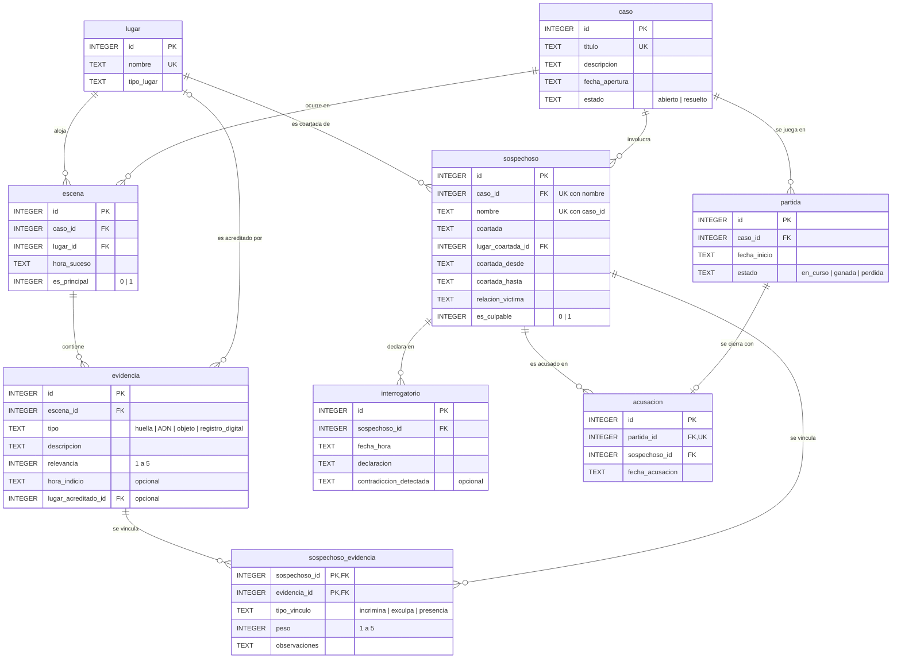

# Modelo de datos de Detective SQL

Fuente única: [`database/detective.sql`](../database/detective.sql). Este documento resume el modelo para el informe y para pasar el MER a Miro.

## MER

Notación: `PK` clave primaria, `FK` clave foránea, `UK` valor único. Cardinalidades en notación pata de gallo: `||` exactamente uno, `o{` cero o muchos, `o|` cero o uno.



Todas las columnas son `NOT NULL` salvo las marcadas como opcionales.

## Modelo relacional

| Tabla | PK | FK (todas `ON DELETE RESTRICT ON UPDATE CASCADE`) | Únicos |
|---|---|---|---|
| `caso` | `id` | — | `titulo` |
| `lugar` | `id` | — | `nombre` |
| `sospechoso` | `id` | `caso_id` → `caso.id`; `lugar_coartada_id` → `lugar.id` | `(caso_id, nombre)`; un culpable por caso |
| `escena` | `id` | `caso_id` → `caso.id`; `lugar_id` → `lugar.id` | una escena principal por caso |
| `evidencia` | `id` | `escena_id` → `escena.id`; `lugar_acreditado_id` → `lugar.id` (admite `NULL`) | — |
| `sospechoso_evidencia` | `(sospechoso_id, evidencia_id)` | `sospechoso_id` → `sospechoso.id`; `evidencia_id` → `evidencia.id` | — |
| `interrogatorio` | `id` | `sospechoso_id` → `sospechoso.id` | — |
| `partida` | `id` | `caso_id` → `caso.id` | — |
| `acusacion` | `id` | `partida_id` → `partida.id`; `sospechoso_id` → `sospechoso.id` | `partida_id` |

Cada FK está indexada para acelerar los JOIN y la verificación de integridad. La mayoría tiene un índice propio (`ix_*`); `sospechoso_evidencia.sospechoso_id` queda cubierta por el índice de la PK compuesta y `acusacion.partida_id`, por el índice de su `UNIQUE`.

## Normalización hasta 3FN

| Forma normal | Cómo se cumple |
|---|---|
| 1FN | Todos los atributos son atómicos. La relación N:M entre sospechosos y evidencias se resuelve con `sospechoso_evidencia`, sin listas dentro de una columna. |
| 2FN | La única PK compuesta es `sospechoso_evidencia (sospechoso_id, evidencia_id)`. `tipo_vinculo`, `peso` y `observaciones` dependen del par completo, no de una sola parte. |
| 3FN | Ningún atributo no clave depende de otro atributo no clave. Las decisiones de abajo eliminan las dependencias transitivas. |

Decisiones de diseño:

- **Tabla `lugar`.** Regla del dominio definida por el equipo: cada lugar tiene un único tipo. Con `ubicacion` y `tipo_lugar` dentro de `escena` existía la dependencia transitiva `escena.id → ubicacion → tipo_lugar`. Al extraer `lugar`, el tipo se guarda una sola vez y escenas, coartadas y lugares acreditados por las evidencias lo referencian por `id`. El descarte de coartadas (C1) compara identificadores en lugar de texto libre.
- **`evidencia` no guarda `caso_id`.** El caso se obtiene por `evidencia.escena_id → escena.caso_id`. Guardarlo agregaría la dependencia transitiva `evidencia.id → escena_id → caso_id` y permitiría que la evidencia y su escena indiquen casos distintos. La coherencia entre casos de los vínculos la garantizan triggers.
- **`partida` no guarda `fecha_fin`.** Toda partida termina con una acusación, y la fecha de cierre es `acusacion.fecha_acusacion`. Guardarla dos veces permitiría valores contradictorios.
- **`evidencia.lugar_acreditado_id` no repite la escena.** Es un hecho propio de cada evidencia (dónde ocurrió lo que demuestra), no se deduce de `escena_id` y puede ser distinto del lugar de la escena o desconocido. Depende solo de `evidencia.id`, así que no agrega dependencias transitivas.

## Lugar del hallazgo y lugar acreditado

Una evidencia describe dos lugares distintos:

| Columna | Significado |
|---|---|
| `escena_id` | Escena donde se encontró la prueba. Siempre se conoce. |
| `lugar_acreditado_id` | Lugar donde ocurrió el hecho que la prueba demuestra, si se conoce. `NULL` cuando la prueba no permite ubicar a nadie. |
| `hora_indicio` | Momento del hecho demostrado, si se conoce. |

Antes de esta corrección las consultas usaban el lugar de la escena como lugar observado. El ticket de Carla se encontró en el archivo, pero prueba una operación en Restaurante Central a las 21:12; para que no pareciera una presencia en el archivo, el ticket tenía `hora_indicio = NULL`. Ahora guarda su hora real y su lugar acreditado.

Criterio para los datos semilla: una evidencia acredita un lugar solo si registra dónde ocurrió el hecho que demuestra (registros digitales, el ticket) o si es un rastro sobre una parte fija de la escena (huellas en el acceso o en el picaporte). Un objeto que se puede trasladar (arma, guante, colilla, pagaré, testamento) no acredita dónde estuvo una persona.

| Evidencia | Hallada en | Lugar acreditado | Hora |
|---|---|---|---|
| 2. Acceso con credencial | Archivo municipal | Archivo municipal | 21:29 |
| 5 y 6. Cámaras del estacionamiento | Estacionamiento municipal | Estacionamiento municipal | 21:19 y 21:22 |
| 7. Pago electrónico | Cafe Bahia | Cafe Bahia | 21:08 |
| 8. Huella en el acceso del archivo | Archivo municipal | Archivo municipal | 20:40 |
| 12. Huella en el picaporte | Archivo municipal | Archivo municipal | sin hora |
| 15. Cámara de Cafe Bahia (Bruno) | Cafe Bahia | Cafe Bahia | 21:30 |
| 17. Cámara del estacionamiento (Elisa) | Estacionamiento municipal | Estacionamiento municipal | 21:30 |
| 18. Ticket de Restaurante Central (Carla) | Archivo municipal | Restaurante Central | 21:12 |

Las evidencias 1, 3, 4, 9, 10, 11, 13, 14 y 16 no acreditan lugar. El mensaje de texto (14) conserva su hora de recepción, 20:55, pero no prueba dónde estaba quien lo envió.

Efecto en las consultas:

- **C1 (coartadas)** compara `evidencia.lugar_acreditado_id` con `sospechoso.lugar_coartada_id` y exige lugar acreditado y hora dentro de la coartada. Una prueba sin lugar acreditado no genera contradicciones. Con la semilla devuelve las mismas seis contradicciones (evidencias 5, 17, 7, 15, 2 y 6); el ticket de Carla coincide con su coartada y no aparece.
- **C3 (veredicto)** descarta a un sospechoso solo con un vínculo `exculpa` cuya evidencia acredita un lugar distinto del de la escena principal, tiene hora y está a 600 segundos o menos del crimen. Una exculpatoria con peso pero sin lugar o sin hora no descarta. Bruno queda descartado por la evidencia 15 y Elisa por la 17; el ticket de Carla (21:12) queda a 18 minutos del crimen y no la descarta. C3 devuelve solo a Carla.

## Comparación de horarios en C3

C3 compara horarios con una tolerancia de diez minutos. La versión anterior calculaba la diferencia con `julianday()`, que devuelve días como número de punto flotante: `ABS((julianday('2026-11-09 21:20:00') - julianday('2026-11-09 21:30:00')) * 1440)` da `10.000000074505806`, y `<= 10` resulta falso para una diferencia de exactamente diez minutos.

Ahora todas las comparaciones de C3 (el registro digital incriminatorio y la prueba exculpatoria) usan segundos enteros:

```sql
ABS(CAST(strftime('%s', ev.hora_indicio) AS INTEGER)
  - CAST(strftime('%s', ec.hora_suceso) AS INTEGER)) <= 600
```

Diez minutos son exactamente 600 segundos. Los tests cubren diferencias de ±599 y ±600 segundos (incluidas), ±601 (excluidas) y pruebas sin hora: `strftime` devuelve `NULL`, la comparación no es verdadera y no hay coincidencias falsas.

## Reglas que impone la base

| Regla | Mecanismo | Nombre |
|---|---|---|
| Las claves foráneas se verifican en cada conexión | `PRAGMA` | `foreign_keys = ON` |
| No se borra un registro referenciado; los cambios de `id` se propagan | FK | `ON DELETE RESTRICT ON UPDATE CASCADE` |
| A lo sumo un culpable por caso | Índice único parcial | `uq_un_culpable_por_caso` |
| A lo sumo una escena principal por caso | Índice único parcial | `uq_escena_principal_por_caso` |
| Nombre de sospechoso único dentro del caso | `UNIQUE` | `uq_sospechoso_nombre` |
| Cada lugar existe una sola vez, con un único tipo | `UNIQUE` | `lugar.nombre` |
| La coartada empieza antes de terminar | `CHECK` | `ck_coartada_fechas` |
| Dominios válidos de estados, tipos, booleanos, relevancia y peso (1 a 5) | `CHECK` | columnas `estado`, `tipo`, `tipo_vinculo`, `es_culpable`, `es_principal`, `relevancia`, `peso` |
| Un solo arresto por partida | `UNIQUE` | `acusacion.partida_id` |
| Sospechoso y evidencia vinculados pertenecen al mismo caso | Trigger | `trg_vinculo_caso_insert`, `trg_vinculo_caso_update` |
| Solo se acusa en una partida en curso y a un sospechoso de su caso | Trigger | `trg_acusacion_validar_insert` |
| Una acusación registrada no se modifica ni se elimina | Trigger | `trg_acusacion_no_update`, `trg_acusacion_no_delete` |
| Registrar una acusación cierra la partida en la misma sentencia: `ganada` si el acusado es culpable, `perdida` si es inocente | Trigger | `trg_acusacion_cerrar_partida` |
| Una partida finalizada no se reabre ni cambia ningún dato (estado, `fecha_inicio`, caso) | Trigger | `trg_partida_finalizada_inmutable` |
| Una partida en curso cierra solo con una acusación cuyo resultado coincide con la culpabilidad | Trigger | `trg_partida_validar_cierre` |
| Toda partida comienza en curso | Trigger | `trg_partida_no_insertar_finalizada` |
| Sospechosos, escenas, evidencias y partidas no cambian de caso | Trigger | `trg_sospechoso_caso_inmutable`, `trg_escena_caso_inmutable`, `trg_evidencia_escena_inmutable`, `trg_partida_caso_inmutable` |
| La culpabilidad no cambia si el sospechoso ya fue arrestado | Trigger | `trg_culpabilidad_historial` |

## Cierre de la partida y transacciones

La acción del juego es el arresto. El cierre de la partida ya no es una sentencia aparte que ejecuta la aplicación: lo hace SQLite.

**Qué garantiza el trigger `trg_acusacion_cerrar_partida`.** Es un trigger `AFTER INSERT ON acusacion`: dentro de la misma sentencia `INSERT` actualiza la partida a `ganada` o `perdida` según `es_culpable` del acusado. Una sentencia de SQLite es atómica: si el cierre falla, se revierte también la acusación. Al terminar cada sentencia, la partida y su acusación quedan consistentes aunque se ejecute SQL directamente, sin la aplicación. La partida que cierra pasa por `trg_partida_validar_cierre`, que acepta el resultado porque la acusación ya está insertada y coincide con la culpabilidad.

**Qué sigue aportando la transacción explícita.** El trigger cubre una sola sentencia. Una acción formada por varias sentencias necesita `BEGIN` ... `COMMIT` para confirmarse completa o `ROLLBACK` para descartarse completa:

- En el script, cada demostración agrupa dos sentencias: crear la partida y registrar la acusación. Sin la transacción, un error en la acusación dejaría una partida abierta de un intento fallido.
- En la aplicación, `registrarArresto` ([`backend/services/partidas.js`](../backend/services/partidas.js)) comprueba que la partida exista, inserta la acusación, lee el estado guardado por SQLite, la acusación y el culpable, todo dentro de una transacción de better-sqlite3. Si cualquier paso falla, incluso después de un `INSERT` ya ejecutado, el `ROLLBACK` deshace la acusación y el cierre. El resultado (`correcto` o `incorrecto`) sale del estado guardado; el backend no repite la regla de victoria. Si la partida siguiera `en_curso` (una base creada sin el trigger), el arresto se revierte y la API responde 500.

| Demostración | Qué hace | Estado final |
|---|---|---|
| `COMMIT` | Partida 1 del caso 1 y acusación contra Diego Salas (inocente). No hay `UPDATE`: un `SELECT` antes del `COMMIT` muestra que el trigger ya la cerró como `perdida`, y otra consulta muestra el resultado confirmado. | Una partida `perdida`; el caso sigue `abierto`. |
| `ROLLBACK` | Partida 2 con su acusación (el trigger la cierra como `perdida`), descartadas con `ROLLBACK`. Dos consultas posteriores cuentan las filas. | Ninguna fila de la partida 2. |

- Dentro del script no se provoca un error real: con `sqlite3 -bail` o con `npm run db:init`, el primer error detiene la ejecución y la base quedaría a medio crear.
- Ninguna demostración modifica el caso ni la investigación, así que la base queda lista para jugar nuevas partidas.
- Una base creada antes de esta corrección no tiene la columna `lugar_acreditado_id` ni los triggers nuevos: hay que recrearla con `npm run db:reset` (operación destructiva: borra las partidas jugadas).

## Qué garantiza SQLite y qué depende de la inicialización o de la aplicación

| Regla | Quién la garantiza |
|---|---|
| Acusación y cierre de la partida ocurren juntos y el resultado coincide con `es_culpable` | SQLite: `trg_acusacion_cerrar_partida` y `trg_partida_validar_cierre`. |
| Una sola acusación por partida, solo en partidas en curso y contra un sospechoso del caso | SQLite: `UNIQUE` de `acusacion.partida_id` y `trg_acusacion_validar_insert`. Como la primera acusación ya cierra la partida, una segunda la rechaza el trigger; el `UNIQUE` queda como segunda barrera. |
| Una partida finalizada no se reabre ni cambia sus datos históricos | SQLite: `trg_partida_finalizada_inmutable`. |
| A lo sumo un culpable por caso | SQLite: índice único parcial `uq_un_culpable_por_caso`. |
| Exactamente un culpable en cada caso con sospechosos | Inicialización: `validarCasosJugables` en [`backend/database/crear-base.js`](../backend/database/crear-base.js) falla con un error en español si algún caso no lo cumple, y `npm run db:init` borra la base a medio crear. Los tests lo comprueban. Después de inicializar, un `UPDATE` administrativo podría dejar un caso sin culpable: el índice no lo impide. |
| El culpable no sale del backend antes del arresto | Aplicación: ninguna consulta previa al arresto lee `es_culpable`. |
| El veredicto de C3 coincide con `es_culpable` | Datos semilla y tests. SQLite no mantiene sincronizadas C3 y `es_culpable`: editar evidencias, vínculos o lugares acreditados puede hacer que C3 deduzca otra persona (o nadie) sin que la base lo impida. |

No se agregó un trigger para exigir exactamente un culpable porque bloquearía cargar un caso de a un sospechoso (el primer sospechoso inocente dejaría el caso sin culpable). La validación al inicializar cubre el uso del proyecto sin cambiar el modelo.
