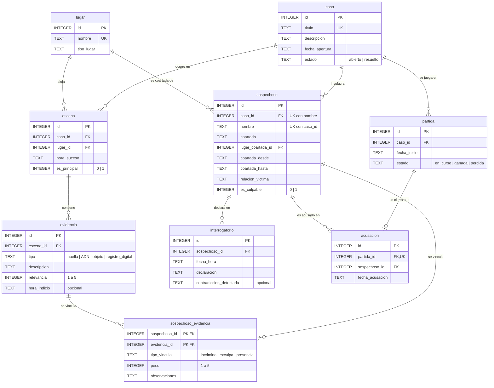

# Modelo de datos de Detective SQL

Fuente única: [`database/detective.sql`](../database/detective.sql). Este documento resume el modelo para el informe y para pasar el MER a Miro.

## MER

Notación: `PK` clave primaria, `FK` clave foránea, `UK` valor único. Cardinalidades en notación pata de gallo: `||` exactamente uno, `o{` cero o muchos, `o|` cero o uno.

Todas las columnas son `NOT NULL` salvo las marcadas como opcionales.

## Modelo relacional

| Tabla | PK | FK (todas `ON DELETE RESTRICT ON UPDATE CASCADE`) | Únicos |
|---|---|---|---|
| `caso` | `id` | — | `titulo` |
| `lugar` | `id` | — | `nombre` |
| `sospechoso` | `id` | `caso_id` → `caso.id`; `lugar_coartada_id` → `lugar.id` | `(caso_id, nombre)`; un culpable por caso |
| `escena` | `id` | `caso_id` → `caso.id`; `lugar_id` → `lugar.id` | una escena principal por caso |
| `evidencia` | `id` | `escena_id` → `escena.id` | — |
| `sospechoso_evidencia` | `(sospechoso_id, evidencia_id)` | `sospechoso_id` → `sospechoso.id`; `evidencia_id` → `evidencia.id` | — |
| `interrogatorio` | `id` | `sospechoso_id` → `sospechoso.id` | — |
| `partida` | `id` | `caso_id` → `caso.id` | — |
| `acusacion` | `id` | `partida_id` → `partida.id`; `sospechoso_id` → `sospechoso.id` | `partida_id` |

Cada FK está indexada para acelerar los JOIN y la verificación de integridad. La mayoría tiene un índice propio (`ix_*`); `sospechoso_evidencia.sospechoso_id` queda cubierta por el índice de la PK compuesta y `acusacion.partida_id`, por el índice de su `UNIQUE`.

## Normalización hasta 3FN

| Forma normal | Cómo se cumple |
|---|---|
| 1FN | Todos los atributos son atómicos. La relación N:M entre sospechosos y evidencias se resuelve con `sospechoso_evidencia`, sin listas dentro de una columna. |
| 2FN | La única PK compuesta es `sospechoso_evidencia (sospechoso_id, evidencia_id)`. `tipo_vinculo`, `peso` y `observaciones` dependen del par completo, no de una sola parte. |
| 3FN | Ningún atributo no clave depende de otro atributo no clave. Las decisiones de abajo eliminan las dependencias transitivas. |

Decisiones de diseño:

- **Tabla `lugar`.** Regla del dominio definida por el equipo: cada lugar tiene un único tipo. Con `ubicacion` y `tipo_lugar` dentro de `escena` existía la dependencia transitiva `escena.id → ubicacion → tipo_lugar`. Al extraer `lugar`, el tipo se guarda una sola vez y escenas y coartadas lo referencian por `id`. El descarte de coartadas (C1) compara identificadores en lugar de texto libre.
- **`evidencia` no guarda `caso_id`.** El caso se obtiene por `evidencia.escena_id → escena.caso_id`. Guardarlo agregaría la dependencia transitiva `evidencia.id → escena_id → caso_id` y permitiría que la evidencia y su escena indiquen casos distintos. La coherencia entre casos de los vínculos la garantizan triggers.
- **`partida` no guarda `fecha_fin`.** Toda partida termina con una acusación, y la fecha de cierre es `acusacion.fecha_acusacion`. Guardarla dos veces permitiría valores contradictorios.

## Reglas que impone la base

| Regla | Mecanismo | Nombre |
|---|---|---|
| Las claves foráneas se verifican en cada conexión | `PRAGMA` | `foreign_keys = ON` |
| No se borra un registro referenciado; los cambios de `id` se propagan | FK | `ON DELETE RESTRICT ON UPDATE CASCADE` |
| A lo sumo un culpable por caso | Índice único parcial | `uq_un_culpable_por_caso` |
| A lo sumo una escena principal por caso | Índice único parcial | `uq_escena_principal_por_caso` |
| Nombre de sospechoso único dentro del caso | `UNIQUE` | `uq_sospechoso_nombre` |
| Cada lugar existe una sola vez, con un único tipo | `UNIQUE` | `lugar.nombre` |
| La coartada empieza antes de terminar | `CHECK` | `ck_coartada_fechas` |
| Dominios válidos de estados, tipos, booleanos, relevancia y peso (1 a 5) | `CHECK` | columnas `estado`, `tipo`, `tipo_vinculo`, `es_culpable`, `es_principal`, `relevancia`, `peso` |
| Un solo arresto por partida | `UNIQUE` | `acusacion.partida_id` |
| Sospechoso y evidencia vinculados pertenecen al mismo caso | Trigger | `trg_vinculo_caso_insert`, `trg_vinculo_caso_update` |
| Solo se acusa en una partida en curso y a un sospechoso de su caso | Trigger | `trg_acusacion_validar_insert` |
| Una acusación registrada no se modifica ni se elimina | Trigger | `trg_acusacion_no_update`, `trg_acusacion_no_delete` |
| Una partida cierra solo con una acusación cuyo resultado coincide con la culpabilidad, y no se reabre | Trigger | `trg_partida_validar_cierre` |
| Toda partida comienza en curso | Trigger | `trg_partida_no_insertar_finalizada` |
| Sospechosos, escenas, evidencias y partidas no cambian de caso | Trigger | `trg_sospechoso_caso_inmutable`, `trg_escena_caso_inmutable`, `trg_evidencia_escena_inmutable`, `trg_partida_caso_inmutable` |
| La culpabilidad no cambia si el sospechoso ya fue arrestado | Trigger | `trg_culpabilidad_historial` |

## Transacciones del script

La acción del juego es el arresto: abrir la partida, registrar la acusación y cerrar la partida con su resultado. Las tres operaciones deben ocurrir juntas.

| Demostración | Qué hace | Estado final |
|---|---|---|
| `COMMIT` | Partida 1 del caso 1, acusación contra Diego Salas (inocente) y cierre como `perdida`. Una consulta posterior muestra el resultado. | Una partida `perdida`; el caso sigue `abierto`. |
| `ROLLBACK` | Partida 2 con su acusación, descartadas con `ROLLBACK`. Dos consultas posteriores cuentan las filas. | Ninguna fila de la partida 2. |

- Dentro del script no se provoca un error real: con `sqlite3 -bail` o con `npm run db:init`, el primer error detiene la ejecución y la base quedaría a medio crear.
- En la aplicación, cuando SQLite devuelve un error (por ejemplo, el trigger `trg_partida_validar_cierre` rechaza un resultado incorrecto), el backend ejecuta `ROLLBACK` y no queda ninguna fila parcial. Los tests lo verifican.
- Ninguna demostración modifica el caso ni la investigación, así que la base queda lista para jugar nuevas partidas.
