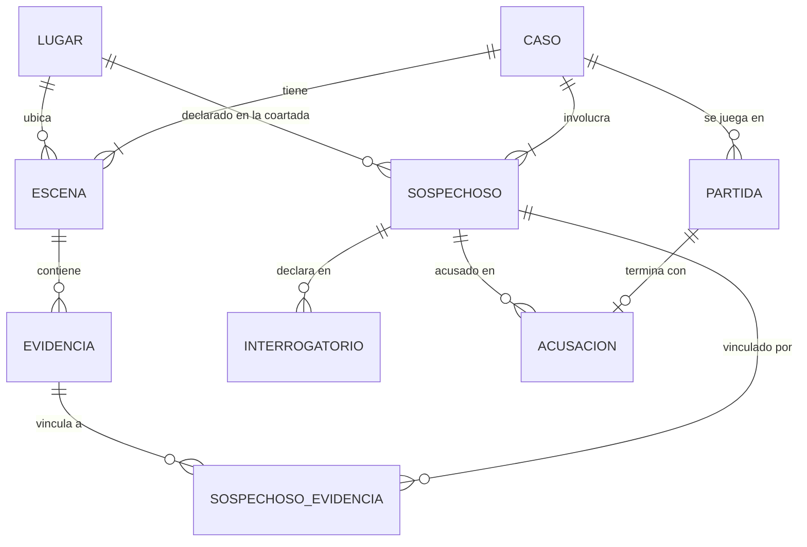

# Revisión del modelo relacional

> **Estado:** propuesta para revisión del equipo. `database/detective.sql` no se escribe hasta que el equipo confirme las decisiones de la sección 1.

El punto de partida son las ocho tablas que propuso el equipo (`caso`, `sospechoso`, `escena`, `evidencia`, `sospechoso_evidencia`, `interrogatorio`, `partida` y `acusacion`). La propuesta sirve, pero así como está no alcanza para cumplir la consigna: faltan claves foráneas hacia el caso, no hay forma de comparar la ubicación declarada con la probada y hay contradicciones del enunciado que cambian el esquema. Este documento lista esos problemas, explica por qué importan y propone una corrección para cada uno.

## 1. Decisiones que el equipo tiene que confirmar

Marcar cada una en el PR (aceptada, cambiada o rechazada) antes de pasar al script SQL.

- [ ] **D1. Tabla `lugar`.** Agregar una novena tabla para comparar la ubicación declarada en la coartada con la ubicación de las escenas por clave foránea, no por texto. Alternativa: dejar `ubicacion` como texto en `escena` y en `sospechoso` (8 tablas, pero la comparación depende de escribir el texto igual y `tipo de lugar` queda con una dependencia transitiva). Ver sección 2, hallazgo H4.
- [ ] **D2. Estado del caso.** El caso pasa a `resuelto` con la primera partida ganada, dentro de la transacción de arresto, y sigue admitiendo partidas nuevas. Ver H1.
- [ ] **D3. Los cuatro sospechosos mienten.** El culpable también tiene coartada falsa; si no, se lo encuentra por descarte con una sola consulta. Ver H5.
- [ ] **D4. Un inocente sin evidencias físicas.** Su mentira surge del interrogatorio, no de una evidencia, para que la consulta anti-join devuelva un resultado útil. Ver H7.
- [ ] **D5. Víctima en el caso.** Agregar `victima` a `caso`, porque `sospechoso` tiene "relación con la víctima" y la víctima no está modelada. Ver H3.
- [ ] **D6. Borrados.** `ON DELETE CASCADE` para el contenido del caso (escenas, evidencias, sospechosos, interrogatorios, vínculos) y `ON DELETE RESTRICT` para el historial de juego (partidas y acusaciones). Ver sección 4.

## 2. Contradicciones y requisitos incompletos de la consigna

| # | Hallazgo | Por qué importa | Propuesta |
|---|---|---|---|
| H1 | El arresto debe "actualizar el estado del caso cuando corresponda", pero el juego tiene que permitir partidas nuevas y el script no puede dejar el caso inutilizable. | Si `resuelto` bloquea nuevas partidas, el juego se puede jugar una sola vez. | El caso pasa a `resuelto` al ganar una partida; ese estado informa, no bloquea (D2). |
| H2 | La Pantalla 1 muestra "fecha y ubicación" del crimen, pero `caso` solo tiene fecha de apertura. | Si se agregan columnas de ubicación y hora al caso, se duplican los datos de la escena principal. | Fecha, hora y lugar del crimen se leen de la escena principal (`es_principal = 1`). |
| H3 | `sospechoso` tiene "relación con la víctima", pero ninguna entidad guarda quién es la víctima. | La historia no se puede mostrar completa desde la base. | Agregar `victima` a `caso` (D5). |
| H4 | Hay que comparar "ubicaciones declaradas contra ubicaciones demostradas", pero ninguna entidad tiene la ubicación declarada. | La consulta de descarte de coartadas no tiene con qué comparar. | Tabla `lugar` y, en `sospechoso`, el lugar y el horario declarados en la coartada (D1). |
| H5 | "Tres sospechosos inocentes tienen coartadas falsas", pero no dice si el culpable también miente. | Si el culpable dice la verdad, es el único con coartada verdadera y se lo descubre sin cruzar evidencias. | Los cuatro mienten (D3). |
| H6 | La matriz de incriminación y la consulta 10 son públicas durante la partida. | Si el sospechoso más incriminado es siempre el culpable, la matriz resuelve el caso sola. | Diseñar los datos para que haya que cruzar condiciones, por ejemplo con un inocente muy incriminado que tiene una evidencia exculpatoria. |
| H7 | La consulta 5 (anti-join) busca sospechosos sin evidencias, pero si los cuatro tienen evidencias el resultado siempre está vacío. | La consulta es válida, pero no demuestra nada. | Un inocente cuya mentira se descubre por interrogatorio y no tiene evidencias físicas (D4). |
| H8 | El script debe demostrar un `ROLLBACK`, pero un error real dentro del script corta su ejecución (tanto en el CLI `sqlite3 -bail` como en `better-sqlite3`). | Un error provocado a propósito rompe `npm run db:init`. | En el script, `ROLLBACK` explícito con una consulta que muestra que no quedaron cambios; el `ROLLBACK` ante un error real se prueba en el backend y en los tests. |
| H9 | El script debe incluir una transacción con `COMMIT` y no puede dejar el caso inutilizable. | Si la demostración gana una partida, el caso arranca `resuelto`. | La demostración con `COMMIT` registra una partida con una acusación incorrecta (`perdida`), que no cambia el estado del caso. |

## 3. Revisión tabla por tabla

Convenciones de la propuesta:

- Fechas y horas como `TEXT` en formato `AAAA-MM-DD HH:MM`, validadas con `CHECK (strftime('%Y-%m-%d %H:%M', columna) = columna)`. SQLite no tiene tipo de fecha y así las comparaciones entre horarios funcionan aunque el crimen cruce la medianoche.
- Booleanos como `INTEGER` con `CHECK (columna IN (0, 1))`.
- Todas las claves primarias son `INTEGER PRIMARY KEY`, salvo la de la tabla intermedia, que es compuesta.

### `lugar` (nueva, D1)

| Columna | Tipo y restricciones |
|---|---|
| `id` | `INTEGER PRIMARY KEY` |
| `nombre` | `TEXT NOT NULL UNIQUE` |
| `tipo` | `TEXT NOT NULL` (vivienda, comercio, vía pública, etc.) |

**Por qué:** en la propuesta, `escena` tenía `ubicacion` y `tipo de lugar`. El tipo depende de la ubicación, no de la escena (`ubicacion → tipo`), y eso es una dependencia transitiva. Además, el lugar declarado en una coartada puede no ser una escena del crimen (por ejemplo, "estaba en el cine"), así que necesita existir por sí mismo.

### `caso`

| Columna | Tipo y restricciones |
|---|---|
| `id` | `INTEGER PRIMARY KEY` |
| `titulo` | `TEXT NOT NULL UNIQUE` |
| `descripcion` | `TEXT NOT NULL` |
| `victima` | `TEXT NOT NULL` (nueva, D5) |
| `fecha_apertura` | `TEXT NOT NULL`, formato `AAAA-MM-DD` |
| `estado` | `TEXT NOT NULL DEFAULT 'abierto' CHECK (estado IN ('abierto', 'resuelto'))` |

**Cambio:** se agrega `victima`. No se agregan lugar ni hora del crimen (H2).

### `escena`

| Columna | Tipo y restricciones |
|---|---|
| `id` | `INTEGER PRIMARY KEY` |
| `caso_id` | `INTEGER NOT NULL` → `caso(id)` (nueva) |
| `lugar_id` | `INTEGER NOT NULL` → `lugar(id)` (reemplaza ubicación y tipo de lugar) |
| `descripcion` | `TEXT NOT NULL` |
| `fecha_hora` | `TEXT NOT NULL`, hora del suceso |
| `es_principal` | `INTEGER NOT NULL DEFAULT 0 CHECK (es_principal IN (0, 1))` |

**Restricción extra:** una sola escena principal por caso, con el índice único parcial `ON escena(caso_id) WHERE es_principal = 1`.

**Cambio:** sin `caso_id` no hay forma de saber a qué caso pertenece una escena, y `GET /api/casos/:id/escenas` no se puede resolver.

### `sospechoso`

| Columna | Tipo y restricciones |
|---|---|
| `id` | `INTEGER PRIMARY KEY` |
| `caso_id` | `INTEGER NOT NULL` → `caso(id)` (nueva) |
| `nombre` | `TEXT NOT NULL`, `UNIQUE (caso_id, nombre)` |
| `relacion_victima` | `TEXT NOT NULL` |
| `coartada` | `TEXT NOT NULL`, el relato que ve el jugador |
| `lugar_declarado_id` | `INTEGER NOT NULL` → `lugar(id)` (nueva) |
| `coartada_desde` | `TEXT NOT NULL`, inicio del horario declarado (nueva) |
| `coartada_hasta` | `TEXT NOT NULL`, `CHECK (coartada_desde < coartada_hasta)` (nueva) |
| `es_culpable` | `INTEGER NOT NULL DEFAULT 0 CHECK (es_culpable IN (0, 1))` |

**Restricción extra:** como máximo un culpable por caso, con el índice único parcial `ON sospechoso(caso_id) WHERE es_culpable = 1`. Que haya exactamente uno lo verifica un test.

**Cambio:** el lugar y el horario declarados son los campos que pide la consigna para comparar ubicaciones. La coartada es falsa si una evidencia demuestra que el sospechoso estuvo en una escena de otro lugar dentro de ese horario.

### `evidencia`

| Columna | Tipo y restricciones |
|---|---|
| `id` | `INTEGER PRIMARY KEY` |
| `escena_id` | `INTEGER NOT NULL` → `escena(id)` |
| `tipo` | `TEXT NOT NULL CHECK (tipo IN ('huella', 'ADN', 'objeto', 'registro digital'))` |
| `descripcion` | `TEXT NOT NULL` |
| `relevancia` | `INTEGER NOT NULL CHECK (relevancia BETWEEN 1 AND 5)` (Regla 1) |

**Sin cambios de fondo.** No lleva `caso_id`: el caso se obtiene a través de la escena, y guardarlo sería una dependencia transitiva (sección 5).

### `sospechoso_evidencia`

| Columna | Tipo y restricciones |
|---|---|
| `sospechoso_id` | `INTEGER NOT NULL` → `sospechoso(id)` |
| `evidencia_id` | `INTEGER NOT NULL` → `evidencia(id)` |
| `tipo_vinculo` | `TEXT NOT NULL CHECK (tipo_vinculo IN ('incriminatoria', 'presencia', 'exculpatoria'))` |
| `peso` | `INTEGER NOT NULL CHECK (peso BETWEEN 1 AND 5)` |
| `observaciones` | `TEXT` (opcional) |

**Clave primaria:** `(sospechoso_id, evidencia_id)`.

**Por qué estos atributos:** `tipo_vinculo` separa lo que incrimina de lo que solo prueba presencia o exculpa, como exige la matriz. `peso` no repite `evidencia.relevancia`: la misma huella puede pesar 5 para quien niega haber estado en el lugar y 1 para el dueño de casa.

**Regla 4:** un trigger impide vincular un sospechoso con una evidencia de otro caso, en `INSERT` y en `UPDATE`.

### `interrogatorio`

| Columna | Tipo y restricciones |
|---|---|
| `id` | `INTEGER PRIMARY KEY` |
| `sospechoso_id` | `INTEGER NOT NULL` → `sospechoso(id)` |
| `declaracion` | `TEXT NOT NULL` |
| `contradiccion` | `TEXT`, `NULL` cuando no se detectó ninguna |

**Cambio:** la contradicción es texto opcional en lugar de un booleano más un texto; el booleano sería un dato derivado (`contradiccion IS NOT NULL`).

### `partida`

| Columna | Tipo y restricciones |
|---|---|
| `id` | `INTEGER PRIMARY KEY` |
| `caso_id` | `INTEGER NOT NULL` → `caso(id)` |
| `estado` | `TEXT NOT NULL DEFAULT 'en_curso' CHECK (estado IN ('en_curso', 'ganada', 'perdida'))` (Regla 2) |
| `fecha_inicio` | `TEXT NOT NULL DEFAULT CURRENT_TIMESTAMP` |

**Regla 5:** un trigger impide cambiar el estado de una partida que ya no está `en_curso`, así el resultado no se puede modificar.

**No se agrega** `fecha_fin`: es la fecha de la acusación.

### `acusacion`

| Columna | Tipo y restricciones |
|---|---|
| `id` | `INTEGER PRIMARY KEY` |
| `partida_id` | `INTEGER NOT NULL UNIQUE` → `partida(id)` (Regla 3) |
| `sospechoso_id` | `INTEGER NOT NULL` → `sospechoso(id)` |
| `fecha_hora` | `TEXT NOT NULL DEFAULT CURRENT_TIMESTAMP` |

**Triggers:** el sospechoso tiene que ser del mismo caso que la partida (Regla 4); la partida tiene que estar `en_curso` (Regla 5); una acusación no se modifica ni se borra.

**No se agrega** `es_correcta`: se obtiene del sospechoso acusado y guardarlo duplicaría `es_culpable`.

## 4. Relaciones y cardinalidades

| Relación | Cardinalidad | `ON DELETE` | `ON UPDATE` |
|---|---|---|---|
| `caso` → `escena` | 1:N | `CASCADE` | `CASCADE` |
| `caso` → `sospechoso` | 1:N | `CASCADE` | `CASCADE` |
| `caso` → `partida` | 1:N | `RESTRICT` | `CASCADE` |
| `lugar` → `escena` | 1:N | `RESTRICT` | `CASCADE` |
| `lugar` → `sospechoso` (lugar declarado) | 1:N | `RESTRICT` | `CASCADE` |
| `escena` → `evidencia` | 1:N | `CASCADE` | `CASCADE` |
| `sospechoso` ↔ `evidencia` (vía `sospechoso_evidencia`) | N:M | `CASCADE` | `CASCADE` |
| `sospechoso` → `interrogatorio` | 1:N | `CASCADE` | `CASCADE` |
| `partida` → `acusacion` | 1:0..1 | `RESTRICT` | `CASCADE` |
| `sospechoso` → `acusacion` | 1:N | `RESTRICT` | `CASCADE` |

Con esta combinación, un caso sin partidas se puede borrar con todo su contenido, y un caso con partidas jugadas no se puede borrar (D6).

## 5. Normalización hasta 3FN

- **1FN:** todos los valores son atómicos. El horario de la coartada se guarda en dos columnas (`coartada_desde`, `coartada_hasta`) y ninguna columna guarda listas.
- **2FN:** la única clave compuesta es la de `sospechoso_evidencia`, y sus atributos (`tipo_vinculo`, `peso`, `observaciones`) dependen del par sospechoso-evidencia completo. Por eso no se le agrega `caso_id`: dependería solo de `sospechoso_id`.
- **3FN:** ningún atributo depende de otro atributo que no sea clave.
  - `tipo de lugar` dependía de la ubicación: se movió a `lugar`.
  - `evidencia` no guarda `caso_id`, porque se obtiene de la escena (`evidencia → escena → caso`).
  - `caso` no guarda lugar ni hora del crimen, porque se obtienen de la escena principal.

**Datos derivados que no se guardan:** acierto de la acusación, fecha de fin de la partida y nivel de incriminación. Se calculan con consultas y con la vista.

**Redundancia controlada:** `caso.estado` y `partida.estado` se podrían deducir de las acusaciones, pero la consigna los exige. Las formas normales se evalúan dentro de cada tabla, así que no las violan; la consistencia la garantiza la transacción de arresto, que actualiza los estados en el mismo bloque que registra la acusación.

**Integridad entre casos:** se resuelve con triggers y no con columnas `caso_id` repetidas, justamente para no romper 2FN ni 3FN.

## 6. Reglas impuestas por la base

| Regla | Mecanismo | Dónde |
|---|---|---|
| 1. Relevancia de 1 a 5 | `CHECK` | `evidencia.relevancia` |
| 2. Estados válidos | `CHECK` | `caso.estado`, `partida.estado` |
| 3. Un arresto por partida | `UNIQUE` | `acusacion.partida_id` |
| 4. Integridad entre casos | Claves foráneas y triggers | `sospechoso_evidencia` (`INSERT`, `UPDATE`) y `acusacion` (`INSERT`) |
| 5. Partidas finalizadas | Triggers | `acusacion` (`INSERT` solo con partida `en_curso`) y `partida` (resultado inmutable) |
| 6. Atomicidad del arresto | Transacción con `COMMIT` y `ROLLBACK` | Backend y demostración en el script |
| Extra: un culpable por caso | Índice único parcial | `sospechoso` |
| Extra: una escena principal por caso | Índice único parcial | `escena` |

En todas las conexiones se ejecuta `PRAGMA foreign_keys = ON;`, porque SQLite no aplica las claves foráneas por defecto.

## 7. Próximo paso

Con las decisiones de la sección 1 confirmadas, se escribe `database/detective.sql`: esquema, datos del caso, las diez consultas, la vista y las transacciones. El caso (personajes, horarios y evidencias) se diseña en ese paso, teniendo en cuenta H5, H6 y H7.
